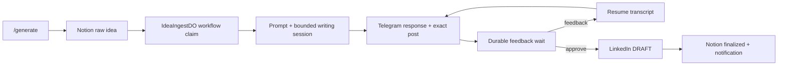

# Research: Substack Notes through Buffer

## Research scope and method

Answer the six questions in [02-research-questions-substack-notes-buffer.md](02-research-questions-substack-notes-buffer.md): Telegram ingress/routing; LinkedIn lifecycle/reuse; writing context/quality; other workflow conventions; Buffer capabilities/delivery; approval/mutation safeguards.

Evidence comes from current source, existing test implementations, and official Buffer documentation, reviewed on 6 November 2026. Three delegated investigations hit a service usage limit; the main agent completed and verified the source review directly. This document describes current behavior, not the future design. No credentials, authenticated API calls, account changes, or publication tests were used.

## Summary

Kipp already separates bounded model sessions from deterministic workflow mutations. LinkedIn has reusable provider execution, transcript persistence, prompt resolution, Telegram transport/routing, cost reporting, OAuth setup helpers, and encrypted credential storage. Its orchestration also directly owns Notion idea lookup/status changes and LinkedIn draft creation.

Reuse does not imply identical lifecycle semantics. LinkedIn counts feedback events rather than successful revisions, can finish immediately after sending its last revision, and does not intrinsically bind old approval buttons to the exact text originally reviewed. Its local naming calls draft creation “published,” although the external request explicitly creates a DRAFT.

Buffer supports OAuth and automatic Substack Notes publication with explicit link attachments. Publication has observable asynchronous states. Its documented write interface lacks a create idempotency key; a lost response cannot safely be treated as a failed write. OAuth refresh rotation also requires behavior that the current token vault does not implement.

## 1. Telegram uses per-chat routing, with different start and deduplication paths

The webhook checks its secret header and the optional allowed user ID before processing callbacks/messages. Commands support Telegram bot-command entities, addressed commands, and a text fallback. Direct replies to bot messages are routed before command handling; callbacks are acknowledged before resolution. See `src/triggers/telegram-webhook.ts:64`, `:116`, `:122`, `:176`.

| Entry | Current behavior |
| --- | --- |
| /add | Uses a chat/message-derived ingest key and stores a raw Notion idea; does not start drafting. |
| /generate | Selects a raw Notion idea, then uses IdeaIngestDO's deterministic per-page workflow claim. |
| /calendar, /mealplan | Call their workflow binding's create method directly; no deterministic ID is supplied at these generation entry points. |
| Post-save Calendar/meal feedback | Starts an edit instance with a deterministic hash-based ID; on a lost create response it checks whether that instance exists. |

Sources: `src/triggers/telegram-webhook.ts:205`, `:235`, `:254`, `:279`; `src/core/idea-ingest.ts:99`, `:156`; `src/core/edit-workflow.ts:5`.

Each chat has a separate router Durable Object, named by chat ID. A registration stores workflow, interaction kind, version, expiry, optional callback token/message ID, and optional group/generation/edit metadata. Resolution looks up callback token first, otherwise reply-to message ID, otherwise the newest eligible plain-text registration. A normal interaction is consumed once. The webhook then selects the workflow binding by interaction kind and forwards identity, text, version, interaction ID, and Telegram update ID. Sources: `src/core/interaction-router-client.ts:29`; `src/core/interaction-router.ts:274`, `:312`; `src/triggers/telegram-webhook.ts:344`.

There is no general ambiguity check for unthreaded feedback. Registering REVISION_FEEDBACK deletes all prior unconsumed registrations of that kind within the chat, regardless of workflow. Group/version or generation invalidation exists separately when the caller supplies that metadata. The README documents concurrent same-chat feedback as unsupported; GitHub #101 tracks future support. Sources: `src/core/interaction-router.ts:197`, `:238`, `:245`, `:253`; `README.md:370`.

## 2. LinkedIn persists a writing transcript but owns Notion-specific orchestration

The generation step resolves the prompt, loads Notion title/body, creates the conversation, runs the native-tool agent, calculates cost, and returns a size-checked state containing review text, exact post, complete persistable messages, chat ID, model, and cumulative usage. It also sets the Notion status to awaiting-feedback. Prompt contents live in the persisted system message, so revision does not re-fetch the prompt. Sources: `src/linkedin/workflow.ts:282`, `:298`, `:313`, `:344`; `src/agent/linkedin.ts:41`.

Notification and router registration are separate durable steps. Successful step results can be restored on replay, including transcript, usage, generated interaction tokens, and recorded publication result. This is checkpoint reuse, not a guarantee that an external operation whose response/checkpoint was lost happens once. Sources: `src/linkedin/workflow.ts:368`, `:386`, `:479`; `src/__tests__/workflow.test.ts:325`, `:874`, `:922`.

The feedback deadline is fixed from the workflow event timestamp. Its configured duration defaults to twelve hours but the code caps it at eleven hours forty-five minutes. This is the application's current cap; this investigation did not verify the current Cloudflare platform maximum. Expiry changes Notion status without deleting content. Sources: `src/linkedin/workflow.ts:20`, `:51`, `:256`, `:400`.

## 3. Prompt resolution and schema checks exist; an author-quality gate does not

LinkedIn tries PROMPT_STYLE_PATH, then style-prompt.md, then bundled default content. Only a GitHub 404 advances to the next candidate; other failures propagate. The resolver records source and SHA when available, but accepts returned contents without checking for blank text. Sources: `src/linkedin/prompts/resolver.ts:11`; `src/linkedin/workflow.ts:298`.

The production agent exposes one submission tool, with separately validated response and post fields: nonblank strings, maximum 1,500 and 3,000 characters respectively. The response is review commentary; only post goes into the external LinkedIn draft. The model has no publishing/credential tool. Feedback appends a real user turn and the tool produces a complete replacement. Sources: `src/agent/linkedin.ts:8`, `:12`, `:21`, `:51`, `:69`.

Shared runTools enforces allowlists, input/output validation through ToolGuard, serial tool execution, isolated handoffs, and bounded repair after prose-only output. Default limits are three provider turns and four tool calls per model session. These are distinct from workflow revision limits. Persistable messages remove provider reasoning fields. A separate helper bounds serialized step outputs below 900 KiB. Sources: `src/runtime/tool-runner.ts:5`, `:69`; `src/runtime/agent-session.ts:19`; `src/core/conversation.ts:3`, `:27`.

The bundled LinkedIn style recommends 150–300 words, hooks, takeaways, and engagement questions. Those are prompt instructions, not schema-enforced editorial quality measures. No standalone LinkedIn author-voice or audience-quality evaluation suite was found in the inspected test directories. The older `src/agent/draft.ts:14` contains another LinkedIn-specific format directive; PipelineWorkflow's production path calls the native-tool agent instead.

## 4. Review controls and loop limits do not equal exact-content approval

LinkedIn's draft controls carry a version but omit interactionGroup/generation. The webhook forwards the version, while PipelineWorkflow uses reply text without comparing that version against the current candidate. Thus an older unconsumed approval token can reach a later wait and approve the current post. Consuming one interaction does not consume its sibling buttons. Sources: `src/linkedin/workflow.ts:72`, `:396`, `:418`, `:460`; `src/triggers/telegram-webhook.ts:455`; `src/core/interaction-router.ts:304`.

MAX_FEEDBACK_ROUNDS is four and counts loop iterations. A Revise tap sends “Type your revision feedback” and continues to the next iteration without calling the model. Real feedback generates and sends a replacement. Feedback on the last iteration can therefore produce a review message immediately before the workflow returns feedback-limit-reached, with no subsequent approval wait. Sources: `src/linkedin/workflow.ts:21`, `:396`, `:440`, `:566`, `:617`, `:638`.

On approval, LinkedIn retrieves credentials, creates a DRAFT through /v2/ugcPosts, finalizes the Notion page, and notifies Telegram. Missing credentials or HTTP 401 invoke a Retry/Cancel reconnect prompt. Other mutation failures return publish-failed. The adapter does not send an idempotency key or reconcile a lost response. Sources: `src/linkedin/workflow.ts:476`, `:513`, `:534`; `src/integrations/linkedin.ts:45`, `:62`.

These findings describe the existing flow; they do not authorize changing LinkedIn behavior.

## 5. Other workflows share runtime services while keeping domain policies separate

Calendar and meal-planning have thin Workflow entrypoints that dispatch generation versus editing. Both use bounded agent sessions and deterministic workflow-owned writes. Calendar stores post-save edit context in the per-chat router; meals store it in D1. Edit workflows validate owner/deadline/baseline and claim a per-resource lock. Generation completes after save, notification, and feedback registration; later edits use new instances. Sources: `src/calendar/workflow.ts:17`; `src/calendar/agent-workflow.ts:78`, `:504`, `:579`, `:643`; `src/meal-planning/workflow.ts:20`; `src/meal-planning/agent-workflow.ts:771`; `docs/workflow-edit-lifecycle.md`.

Shared action prompts split notify/register/wait into durable steps and distinguish callbacks from free text. Their wait is currently fixed at fifteen minutes, even though registration accepts a TTL. Workflow event adaptation treats actual wait timeouts as an outcome and rethrows runtime interruptions. Sources: `src/core/action-prompt.ts:51`, `:113`; `src/core/workflow-events.ts:6`, `:18`.

OAuth setup uses Cloudflare Access authorization, a provider-specific secure HttpOnly cookie, short-lived single-use server state, a callback, and encrypted token storage. The vault currently supports LinkedIn and Google Calendar only; it stores/reads token envelopes and OAuth state, without a refresh operation, PKCE verifier storage, or a serialized rotating-refresh protocol. Google refresh currently happens outside the vault and retains its existing refresh token. Sources: `src/triggers/oauth.ts:5`; `src/triggers/linkedin-auth.ts:15`; `src/triggers/google-calendar-auth.ts:34`; `src/core/token-vault.ts:26`, `:97`, `:122`; `src/integrations/google-calendar.ts:233`.

No Buffer publishing client, workflow, token provider, or PKCE implementation was found in src/config/manifests. Runtime changes must update Env, the value-free runtime variable contract, and local/production provisioning. Production binding/workflow structure belongs in wrangler.prod.toml; Dashboard owns actual values/secrets. Architecture inventory changes belong in docs/architecture/architecture.yaml and affected diagrams. Sources: `src/core/types.ts:1`, `:186`; `src/index.ts`; `wrangler.prod.toml`; `docs/production-runtime-configuration.md`; `docs/architecture/README.md`.

## 6. Buffer exposes channel discovery, immediate delivery, and status retrieval

### Substack supports plain text and one link card

Buffer's Substack integration supports automatic top-level Notes, a 10,000-character ceiling with full URLs counted, plain text, and link cards. Replies, native restacks, threads, rich formatting, and editing/deleting already-published Notes through Buffer are not supported. The editorial goal of a brief Note is much shorter than the platform limit. [Substack support](https://support.buffer.com/articles/using-substack-with-buffer-lDbUYyIq4R)

A card is metadata, not an asset: metadata.substack.linkAttachment contains a required URL and optional title/description/thumbnail. It cannot accompany a nonempty assets array. Kipp need not fetch the article body merely to attach the card. Exact native-style rendering for Substack article URLs was not tested. [Attachment guide](https://developers.buffer.com/guides/hosting-media), [Substack metadata input](https://developers.buffer.com/types/SubstackPostMetadataInput.html)

### OAuth is available, and refresh tokens are single-use

App Clients can be registered in Buffer settings. OAuth uses Authorization Code with PKCE. Access tokens last about an hour; offline_access requests refresh tokens. Each refresh rotates the token, and reuse of an old refresh token revokes the grant. Relevant documented scopes include account:read for organizations/channels, posts:read, posts:write, and offline_access. Public/private client registration details must be validated for the eventual deployment. [Building Apps](https://developers.buffer.com/guides/building-apps.html), [Authentication](https://developers.buffer.com/guides/authentication)

### An accepted post is not necessarily published

Buffer's GraphQL endpoint is https://api.buffer.com. Organizations/channels can be discovered, and channel fields include service, organizationId, isDisconnected, isLocked, and allowedActions. Shared post inputs coexist with service-specific metadata, so channel capabilities differ. [Channel schema](https://developers.buffer.com/types/Channel.html), [Quick start](https://developers.buffer.com/guides/your-first-post.html)

Immediate publication uses mode: shareNow with schedulingType: automatic. The create input also exposes draft/approval settings; schema defaults and posting-role constraints must be validated before account-level use. Mutation success returns a post, not a promise that its external publication has finished. [Migration guide](https://developers.buffer.com/guides/rest-migration.html), [Create input](https://developers.buffer.com/types/CreatePostInput.html), [Success payload](https://developers.buffer.com/types/PostActionSuccess.html)

Observable states are draft, needs_approval, scheduled, sending, sent, and error. The post schema exposes externalLink (nullable), sentAt, and publishing error information. The API supports post-by-ID and paginated organization posts filtered by channel, creation time, and status. [Post status](https://developers.buffer.com/types/PostStatus.html), [Post schema](https://developers.buffer.com/reference.html#Post), [Post filters](https://developers.buffer.com/types/PostsFiltersInput.html)

### Writes cannot be blindly retried after losing a response

Buffer's guidance explicitly warns that create_post has no idempotency key and repeating a successful write after losing its response can publish twice. The GraphQL CreatePostInput likewise exposes no idempotency field. Buffer recommends looking for the created post by channel/time window after an uncertain response; its guide also states that no webhooks are available. [Efficient API usage](https://developers.buffer.com/guides/efficient-api-usage.html), [Create input](https://developers.buffer.com/types/CreatePostInput.html)

Inference: a known post ID permits targeted polling, but a matching text/link/time window is not a documented unique operation identity. No match in one page, delayed visibility, or two identical candidates cannot prove that a write never happened. Documentation reviewed provides no exactly-once guarantee for Kipp. Classifying safe retries and unresolved outcomes remains technical-design work.

Typed mutation errors are distinct from transport/GraphQL envelope errors; HTTP success alone does not establish mutation success. Documented payload members include success, authorization, not-found, invalid-input, limit, and unexpected errors. [Mutation response](https://developers.buffer.com/types/PostActionPayload.html)

OAuth App Clients have their own quotas, separate from personal API keys. Base allowances plus one authorized user currently give 110 requests/15 minutes, 525/day, and 15,100/30 days. Free permits one App Client. HTTP 429 and Retry-After, plus RateLimit headers, expose throttling. These are current documented limits, not observed account entitlement. [Rate limits](https://developers.buffer.com/guides/api-limits.html)

## Existing tests exercise contracts; Buffer has no test coverage yet

| Area | Existing tests and what they establish |
| --- | --- |
| LinkedIn agent | src/__tests__/linkedin-agent.test.ts:16: clean output, transcript/feedback preservation, reasoning removal, schema boundaries, rejection of hallucinated publishing and prose-only repair. |
| Prompt resolution | src/__tests__/resolver.test.ts:18: path priority, 404 fallback, propagation of other errors, source/SHA reporting. |
| LinkedIn workflow | src/__tests__/workflow.test.ts:255: deadline, reconnect, replay, cumulative costs, review/publish text separation, transcript size, separated notification registration. Uses workflow/provider mocks; checkpoint replay is simulated. |
| LinkedIn integrated flow | src/__integration__/workflow-approval-to-linkedin-draft.integration.test.ts:108: production workflow with fake Cloudflare entrypoint, network, step, router; approval, revision, expiry, provider denial, credential-safe failure. |
| Telegram routing | src/__integration__/telegram-approval-routing.integration.test.ts:24: callbacks/plain text/replies and command routing, with fake router. Does not establish independent concurrent feedback. |
| Router | src/__tests__/interaction-router.test.ts:53 and :170: expiry cleanup, generation invalidation, edit owner/locks, duplicate deterministic edit starts, SQLite reconstruction; a mix of SQL mocks and real SQLite fixtures. |
| OAuth/vault | src/__tests__/token-vault.test.ts:187, :324; google-calendar-auth.test.ts:47; linkedin-auth.test.ts: encryption, provider isolation, state consumption, setup authorization/callbacks with fake service boundaries. |
| Shared tool runtime | src/__tests__/tool-runner.test.ts:6: tool allowlists/schema checks, batching, bounded repair, handoff, fatal failures and budget behavior. |
| Actual workflow runtime | src/__integration__/calendar-telegram-workflow.integration.test.ts:979; meal-planning-telegram-workflow.integration.test.ts:741: Miniflare/Workerd persistence and reboot at write/notification/registration boundaries with external service fakes. |

No Buffer client/account or live Notes rendering test exists in the inspected tree. Tests were read, not run, for this research. Earlier session checks validated the README-only commit; they are not Buffer validation.

## Code references and architecture documentation

Key-file coverage, not an exhaustive inventory:

- **Ingress/authority:** src/triggers/telegram-webhook.ts; src/core/interaction-router{,-client}.ts; src/core/action-prompt.ts; src/core/edit-workflow.ts; src/core/workflow-events.ts.
- **Writing:** src/linkedin/workflow.ts; src/agent/linkedin.ts; src/linkedin/prompts/{resolver,defaults}.ts; src/runtime/{agent-session,tool-runner,tools}.ts; src/core/conversation.ts.
- **Source/mutation:** src/core/idea-ingest.ts; src/linkedin/ideas/manager.ts; src/integrations/{notion,linkedin,telegram}.ts.
- **OAuth:** src/triggers/{oauth,linkedin-auth,google-calendar-auth}.ts; src/core/{token-vault,token-vault-client,crypto,types}.ts; src/integrations/google-calendar.ts.
- **Runtime conventions:** src/{calendar,meal-planning}/{workflow,agent-workflow}.ts; src/index.ts; wrangler.prod.toml; config/runtime-variables.json; docs/production-runtime-configuration.md; docs/workflow-edit-lifecycle.md; docs/architecture/README.md.

## Open questions requiring account-level or targeted implementation validation

1. Actual App Client creation/permissions, Substack posting role, account/channel identity, and expiry/rotation behavior in the chosen Buffer account.
2. Actual shareNow response state, transition timing, externalLink availability, and recovery of failed existing posts without creating duplicates.
3. Exact Substack article link-card appearance, redirects/private/dead links, and metadata normalization during reconciliation.
4. No documented unique create identifier or visibility guarantee resolves all lost-response cases; unresolved outcomes must remain explicit.

The public feasibility gate is answered. These remaining unknowns do not justify claiming successful end-to-end publication or designing an automatic ambiguous retry.

## Follow-up ideation reference — 10 November 2026

Existing Telegram ingress forwards replies as text to the active interaction; LinkedIn treats ordinary reply text as revision feedback, with explicit branches for approval/revise callback markers. This supports transporting conversational replies, but provides no general natural-language phase-switch mechanism. A future “draft now” intent must be implemented as an explicit workflow transition; it cannot be enabled merely by installing a desktop skill. Sources: src/triggers/telegram-webhook.ts:190; src/linkedin/workflow.ts:414, :426, :440, :574.

A promising public reference is Every's [cw-interview](https://github.com/EveryInc/compound-writing/blob/main/skills/cw-interview/SKILL.md), inspected in its [raw source](https://raw.githubusercontent.com/EveryInc/compound-writing/main/skills/cw-interview/SKILL.md). It elicits writer-owned material, separates confirmed intent from model interpretations, allows the writer to move on, and returns material to a subsequent writing stage. It targets outlining rather than brief Notes and defaults to elicitation rather than active challenge. Adapting it to a short brainstorming exchange is a hypothesis to evaluate with real author thoughts, not a proven quality claim.

The candidate is publicly accessible; this is not a claim of public-domain licensing. Check the applicable license before copying/adapting it. No skill was installed or selected as a runtime dependency. Basic drafting remains the first release; prompt selection, exploration behavior, and transition semantics belong to follow-up agent-harness-aais.

## Scheduling and reconnect verification — 10 November 2026

Buffer documents exact-time creation with mode customScheduled, schedulingType automatic, and dueAt as an ISO 8601 UTC timestamp. The scheduled status is distinct from sent; account-level behavior still needs validation. This supports a one-time schedule in addition to the previously researched shareNow path. [Posts & Scheduling](https://developers.buffer.com/guides/posts-and-scheduling.html)

Buffer's current OAuth guide confirms short-lived access tokens, offline_access refresh, rotating single-use refresh tokens, and the need to serialize refreshes. Normal expiry need not require reauthorization; an unusable grant does. [Building Apps](https://developers.buffer.com/guides/building-apps.html)

Current Kipp recovery evidence: LinkedIn prompts for authorization followed by Retry (src/linkedin/workflow.ts:131–157); Calendar automatically refreshes expiring tokens and classifies missing/failed refresh as authorization failure (src/integrations/google-calendar.ts:223–281), then prompts “Reconnect, then tap Retry” (src/calendar/agent-workflow.ts:416). The desired Notes recovery is consistent with those user-facing patterns, while Buffer rotation needs provider-specific coordination. No account operations were performed.

## Durable tracking capabilities — 10 November 2026

Cloudflare documents durable step.sleep and step.sleepUntil, suitable for delaying observation until a Buffer-scheduled due time. Its Workflow step configuration controls retries; default step retries must not be mistaken for safe replay of an external create. [Sleeping and retrying](https://developers.cloudflare.com/workflows/build/sleeping-and-retrying/)

The current repository has Workflow bindings and token-vault alarms, but no Buffer delivery tracker. Buffer's current efficiency guide continues to describe polling/no webhooks and warns about duplicated creates after lost responses. Choosing the delivery owner and mutation guards is TDD work, not behavior already supplied by this repository. [Efficient API usage](https://developers.buffer.com/guides/efficient-api-usage.html)

## Existing timezone configuration — 10 November 2026

Kipp already declares optional TIMEZONE in src/core/types.ts and config/runtime-variables.json. Calendar uses it with an Asia/Kolkata fallback (src/calendar/agent-workflow.ts:85; src/calendar/scheduling.ts:4). Its civil-date/time conversion helpers are potential reuse candidates, not verified daylight-saving disambiguation support for Notes. Notes timezone/default behavior is a TDD decision.

### Inline hyperlink labels versus Buffer output — verified 10 November 2026

Substack documents rich formatting in its native Notes composer. Buffer explicitly documents plain-text Substack Notes output with no rich formatting. Incoming Telegram text_link labels/targets can be preserved as source context, but a clickable custom-label inline hyperlink is not a supported promise through this integration. A selected attached link card remains available. The author subsequently chose one embedded card from the first URL in message order; the multi-link parenthetical fallback is not adopted.

Sources: [Buffer Substack support](https://support.buffer.com/articles/using-substack-with-buffer-lDbUYyIq4R), [Substack Notes formatting](https://support.substack.com/hc/en-us/articles/14742958406036-Can-I-format-text-on-Substack-Notes).

### Program Design review: time alternatives and submission uncertainty — 10 November 2026

The Temporal dependency was recommended before a complete alternatives evaluation; no comparative runtime/bundle prototype had been run. Current Calendar Intl code is the reuse baseline. Luxon source additionally exposes getPossibleOffsets for repeated times; a gap still needs explicit normalization/round-trip checking. Temporal offers explicit disambiguation and civil-date arithmetic. The shared strict resolver contract is settled, while dependency selection is open pending comparison. [Luxon source](https://raw.githubusercontent.com/moment/luxon/master/src/datetime.js), [Temporal time-zone semantics](https://tc39.es/proposal-temporal/docs/timezone.html).

Historical proposal, superseded by the approved PRD/TDD: manual inspection was considered as an unknown-result fallback. The active behavior is terminal failure to confirm, with no inspection-and-retry interaction; inspection is not a Buffer API requirement. Buffer documents no idempotency key and recommends narrow channel/time lookup after a lost response; matching content/time is not unique proof. Current Kipp LinkedIn createDraftPost and Workflow do not implement a mutation guard or uncertain-response reconciliation; generic errors become publish-failed. Public Notes make blind repeated creation more consequential than duplicate LinkedIn drafts. Both integrations share the underlying uncertain-create problem. [Buffer retry guidance](https://developers.buffer.com/guides/efficient-api-usage.html); local sources src/integrations/linkedin.ts and src/linkedin/workflow.ts.

## Executed feasibility spikes — 10 November 2026

| Investigation | Observed evidence | Remaining limit |
| --- | --- | --- |
| [Buffer contracts](../../../docs/research/substack-notes-buffer-contract-spike.md) | Current primary docs and synthetic request/response fixtures; exact output names, required inputs, OAuth rotation and conservative error policy | Subsequent authorized account tests verified OAuth/rotation, all three submission modes and both card types; all test entries removed |
| [Time handling](../../../docs/research/substack-notes-time-spike.md) | Three separate workerd bundles passed 19 common checks; additional Samoa boundary exposes custom Intl limitation; current Calendar gaps reproduced | Recommend strict Luxon 3.7.2 wrapper; production Calendar changes and integrated bundle measurement remain implementation work |
| [Durable recovery](../../../docs/research/substack-notes-durability-spike.md) | Eight real-runtime tests with persistent SQLite/Workflows, checkpoint failure, reconstruction, concurrency and fake external request counters | Isolated protocol proof, not production integration/authentication/encryption or arbitrary crash coverage |

The retained time runner and durable suite were executed, not merely read. No live Buffer/Telegram mutation, production binding, application integration or production dependency was introduced. The TDD and outline now carry these findings. Synthetic fixtures cannot establish real provider error rollback; absent narrow verified no-create evidence, mutation errors remain unknown and cannot authorize another create.

## Buffer can assign a slot through addToQueue — 10 November 2026

The official [scheduling guide](https://developers.buffer.com/guides/posts-and-scheduling.html) documents createPost with mode addToQueue and schedulingType automatic: Buffer uses the next available slot from the channel posting schedule. The [ShareMode enum](https://developers.buffer.com/types/ShareMode.html) also includes shareNow, customScheduled and shareNext. The approved extension uses addToQueue only; shareNext/priority insertion is not selected. The schema-required assets and needsApproval fields still apply.

Queue placement does not require Kipp to compute dueAt or reproduce Buffer recommendations. Any assigned dueAt is response evidence. Actual channel queue behavior remains part of the authenticated Buffer spike; no live queue request has been run.

## Authorized Buffer account verification completed — 10 November 2026

The [live contract report](../../../docs/research/substack-notes-buffer-contract-spike.md#live-account-tests-passed-and-all-test-content-was-removed) and [sanitized captured fixtures](../../../docs/research/fixtures/buffer-live-spike-2026-11-10.json) supersede earlier account-level unknowns for this development account. Browser consent granted all required scopes. One normal refresh rotated both tokens. Six creates verified text-only exact scheduling, queue placement, scheduled cards for external/Substack URLs, and immediate cards for both URL types. Both immediate responses returned sent and a public link. The user confirmed both native cards and deletion of both public Notes; four future entries returned Buffer deletion success.

The saved link metadata returned expandedUrl as an empty string despite correct native rendering; do not require it. Sent post actions omitted deletePost, so published-test cleanup used native Substack, while future test entries were deleted through Buffer. The temporary callback server/tunnel were stopped. OAuth grant storage remained encrypted and ignored locally; no production vault/integration was changed.

Live transport-loss, grant revocation and stale-token reuse were intentionally not induced. Existing conservative unknown handling remains necessary, and typed mutation errors still have no general rollback guarantee. Eventual scheduled delivery was not observed or required. All three feasibility spikes now have their evidence; editorial prompt study and production implementation/provisioning remain separate.
