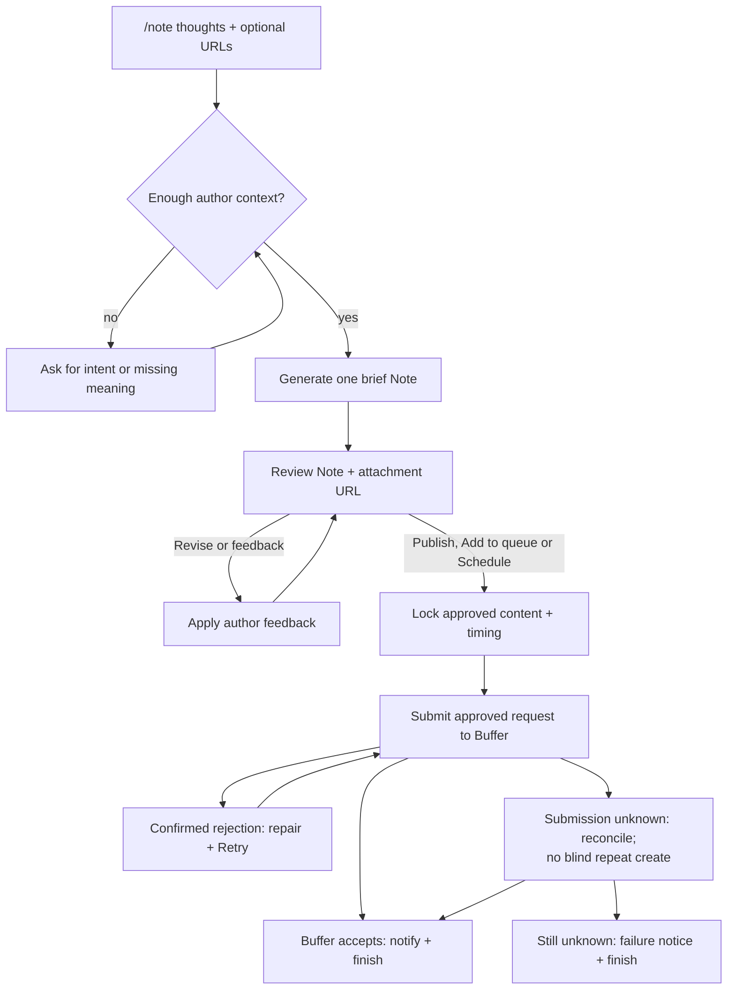

# Publish Substack Notes from Telegram through Buffer

## Problem to Solve

The author wants to publish brief, compelling Substack Notes regularly without turning each thought into a manual drafting and publishing task across apps. They should be able to send raw thoughts to Kipp in Telegram, shape the Note through feedback, and submit the exact approved result to Buffer for immediate, queued or exact-time publication from the same conversation.

Kipp is a collection of configurable personal workflows that other users can adapt. The Notes workflow needs useful defaults and configurable writing instructions, shared infrastructure with LinkedIn, and a Buffer integration that can support additional channels later. Its input is the author's Telegram text, not a Notion idea.

The author confirmed this problem and the interview's product scope. [Request and settled decisions](01-request-substack-notes-buffer.md); [current-system/API research](03-research-substack-notes-buffer.md).

## Success

**Agreed success measure (updated 10 November 2026):** after one-time setup, the author can take a real thought through drafting, feedback, revision and confirmed Buffer acceptance entirely from Telegram. Immediate publication is the default; an explicit queue request uses Buffer's next available posting slot, while an approved future time schedules the Note for that exact time. No editing or approval in Buffer/Substack is required for the normal flow. Buffer is responsible for subsequent publication.

Initial acceptance is a demonstrated workflow, not a posting-frequency, engagement, or latency target. “Regularly” means repeatable user-initiated use; this feature does not generate a cadence or send reminders.

| Evidence | Passing result |
| --- | --- |
| Author acceptance walkthrough | A real thought becomes an acceptable Note through Telegram review; Buffer accepts its exact approved content and Kipp confirms the submission. |
| Queue submission walkthrough | Review says next available Buffer slot; explicit Add to queue approval submits queue mode, and Kipp confirms acceptance with the assigned time when returned. |
| Scheduled submission walkthrough | Review shows the approved future date/time/zone, Buffer confirms the requested schedule, and Kipp confirms scheduling without waiting for publication. |
| Text-only walkthrough | A thought without a URL reaches Buffer acceptance without attachment questions or a card. |
| URL sharing walkthrough | Kipp sends the chosen URL through Buffer's Substack link-card metadata. Both external and Substack article cards were subsequently confirmed in authorized live tests. |
| Authorization and lifecycle checks | No unapproved, stale, expired, or duplicate interaction authorizes submission; the last valid draft remains approvable when its revision budget is exhausted. |
| Submission fault checks | Lost responses and replay do not cause blind duplicate creates or false acceptance claims. An unresolved submission is reported honestly. |
| Reuse/regression checks | Existing LinkedIn draft behavior still works; generic Buffer plumbing supports a channel-specific boundary without adding another live destination in this release. |

Writing quality has a separate unfinished acceptance activity: study standout examples, prepare the configurable default prompt, and review representative outputs for voice, brevity, audience relevance, and fidelity. This PRD does not claim that a prompt or quality benchmark has already been approved.

## Proposed Solution

Provide /note <raw thoughts> in Telegram. Kipp loads one Notes writing prompt, resolves only necessary clarifications, and offers a single proposed Note. The author supplies feedback by replying or tapping Revise. With no scheduling request, Publish authorizes immediate public publication through Buffer for that exact Note and optional link attachment. When the author asks to queue the Note, review says next available Buffer slot and Add to queue authorizes Buffer to select that slot. When the author requests a future time, review shows the resolved date, time, and timezone; Schedule authorizes that exact Note for that time.

Review and retries are bounded by the configured deadline. The diagram shows product states, not a proposed code architecture. Expiry before approval ends the review; it does not undo an already-authorized publication or imply deletion.

## Solution Details

### 1. Setup connects Buffer once and selects one Substack account

The operator registers a Buffer OAuth app for their Kipp deployment and configures its credentials/redirect. The user connects Substack inside Buffer and authorizes Kipp through a Connect Buffer setup flow. Kipp uses OAuth, encrypted credential storage, and automatic refresh. Personal API-key support is outside initial scope.

One Substack account is configured per workflow instance. Routine Telegram reviews do not display a destination label or ask which account to use. Kipp must nevertheless preserve the configured destination as part of publication authority; a connection/configuration change must not silently redirect an existing approval to another account.

An expired access token should refresh automatically when a valid refresh token is available. Missing authorization, revoked access, or an unusable refresh token must prompt the author to reauthorize through Connect Buffer and then tap Retry. Preserve the approved content and timing; reconnecting alone does not authorize another write. Coordinate rotating refresh tokens so concurrent executions cannot invalidate the connection.

Setup and reconnect messages must distinguish authorizing Kipp to Buffer from refreshing Buffer's connection to Substack. If the configured channel is unavailable, explain the required repair rather than substituting another channel. Exact setup fields and channel-selection mechanics are deferred to technical design.

### 2. /note starts with text, with no Notion dependency

The command accepts multiline raw thoughts and optional URLs in its text argument, including labelled hyperlinks when Telegram preserves their destinations as message entities. A URL is never required: text-only Notes proceed without link selection or a card. Empty input shows usage. A URL alone prompts the author for their intended point; Kipp does not fetch or summarize the linked article.

Kipp drafts immediately when there is enough meaning and source material. It asks a clarifying question when proceeding would require inventing the author's meaning or facts. Clarification remains part of the execution and leads back to drafting.

Attachments, voice messages, article retrieval, automatic idea discovery, and saving a Notion idea are outside this input contract. Duplicate delivery of the same Telegram invocation must not create another publication execution.

### 3. Writing configuration supplies audience and author voice

One configurable Notes writing prompt contains the audience, voice, and generally applicable editorial guidance. The Telegram invocation supplies the intent and raw material for that execution. Multiple audience profiles and per-run audience selection are deferred.

Match LinkedIn's resolution behavior: try the configured prompt path, a conventional Notes prompt file, then a bundled Notes fallback. Custom configuration is optional. Missing files can fall through; genuine retrieval errors must not be disguised as missing configuration. Exact paths belong in technical design.

Snapshot the selected prompt for the run, including revisions. New executions pick up prompt changes. Reusing the LinkedIn resolver must not apply LinkedIn's 150–300-word template to Notes.

The desired default is brief and tweet-like: one focused idea, short paragraphs, well under a minute to read. There is no mandatory hook, takeaway, closing question, or fixed template. Detailed editorial instructions and source-inspired examples remain deferred.

### 4. Sharing a URL includes an explicit link card

With no URL, publish a text-only Note and omit attachment UI.

Use the first valid URL in message order as the single embedded card, regardless of whether it points to Substack or another site. A labelled hyperlink counts at the position of its visible text, using the actual destination from Telegram. Ignore subsequent URLs for publication. Do not ask for selection or confirmation, and do not add the remaining URLs to the Note in parentheses. Preserve the attachment across prose revisions unless the author explicitly changes it.

Keep the selected URL in the card rather than repeating it in the Note body. Meaningful hyperlink label wording may inform the prose, but custom-text clickable inline hyperlinks are outside the Buffer-backed output contract. Telegram review separates the exact Note text from “Attached link: <URL>”. Any commentary is separate from publishable content.

Publish, Add to queue or Schedule approval covers the text and attached URL together. Changing either produces a new review requiring fresh approval. The card's generated title/image/description are controlled by Substack/Buffer; Telegram review need not reproduce the exact card artwork.

Buffer documents explicit link attachment metadata. A native restack is a different feature and is outside scope. The author confirmed Substack article and external card appearance in the authorized 10 November spike. This is evidence for the tested URLs/account, not a guarantee for every URL; the integrated workflow still needs release validation. [Research](03-research-substack-notes-buffer.md#substack-supports-plain-text-and-one-link-card)

### 5. Review supports timing-specific approval and feedback-directed Revise

Show one proposed Note with Publish and Revise actions by default. For queue mode, show Add to queue and Revise. For an exact future publication time, show Schedule and Revise instead. Publish posts publicly now; Add to queue delegates slot selection to Buffer's configured posting schedule; Schedule commits to automatic publication at the displayed time. LinkedIn's action still creates a draft.

Tapping Revise asks what should change; it does not immediately regenerate. A direct reply supplies feedback without the extra tap. “Try another version” is valid feedback. Each successful revision replaces the proposed Note and requires fresh Publish, Add to queue or Schedule approval. Superseded controls cannot approve another version or publication time.

The writing agent proposes text and clarification; deterministic workflow code owns validation, review authority, and external publication. Model-generated claims of approval/publication must not grant authority.

No new Cancel button is required for ordinary review. The author can leave a draft unapproved until expiry.

#### Queue placement and exact scheduling are reviewed before approval

The author can request queue placement or an exact publication time in the initial Telegram message or in review feedback, using natural language.

| User instruction | Proposed timing | Approval |
| --- | --- | --- |
| No timing instruction on a new invocation | Immediate | Publish |
| “Add this to my queue” | Next available Buffer slot | Add to queue |
| “Schedule tomorrow at 7pm” | Resolved exact date/time/zone | Schedule |
| “Publish later” or conflicting queue/exact-time instructions | Ask for clarification | None until clarified |

The model proposes one structured timing mode; deterministic code validates it and the author approves the displayed result. During revision, omission preserves the current mode and any exact scheduled time. A normal rewrite never resets timing to immediate. Only explicit timing-change intent proposes another mode.

Queue review shows “Timing: Next available Buffer slot”, not an estimated timestamp. Approval covers the next available slot at submission, not a fixed previewed time. Buffer owns the posting schedule and slot calculation. Kipp does not choose/recommend slots or change Buffer's schedule. After successful queue acceptance, the Telegram confirmation must say “Added to your Buffer queue” and, when Buffer returns the assigned posting time, show its absolute date, time and timezone. Use the run’s known display timezone, or explicitly UTC if none is known. If Buffer omits the time, confirm successful queueing without inventing a timestamp or polling for one. Do not require a timezone configuration merely to request queue placement, or claim a local timezone when none is known.
 Do not require a schedule or a separate flag for ordinary immediate publication. Resolve timing separately from the Note's publishable text.

For exact-time scheduling, use a configured workflow timezone when the author omits one. Show an absolute date, local time, and timezone in that review. Ask for clarification when timezone or timing is ambiguous; never silently infer a timezone from the server. The exact configuration and parsing contract belong in TDD.

Approval covers text, optional URL, destination, and publication timing together. Changing any of these requires fresh review. Reject times already in the past. If a requested time passes during review or reauthorization, ask for a new time or explicit approval to publish now; never silently convert the request to immediate publication.

Submit an approved future Note to Buffer for that exact time rather than holding an unpublished draft in Kipp until then. Confirm scheduling only after Buffer confirms the post and due time. A scheduled acknowledgment completes Kipp's responsibility. Buffer owns publication at the requested time; Kipp does not poll for publication or wait for a Note link. The review deadline limits new approvals and retries, not the future publication date of an already-approved schedule.

Recurring execution, Kipp-managed posting schedules, and changing/canceling an accepted scheduled post through Kipp are outside this release. The author can manage an accepted schedule in Buffer. Once Buffer accepts the Note, later publication failure and repair are managed in Buffer.

### 6. Review expiry and generation limits have different effects

Use LinkedIn's configured feedback window and deadline semantics. When it expires before publication is authorized, reject Publish/Add to queue/Schedule/Revise and explain that a new /note execution is required. Leave visible draft text available for reuse; this is not a deletion policy.

A bounded generation budget limits revisions. Reaching it stops further generation, not the ability to approve the last successfully generated draft before its review deadline. Tapping Revise to request feedback does not itself count as a generated revision. Exact numerical budget and accounting belong in technical design.

Concurrent feedback conversations in the same chat remain unsupported and unenforced, as documented in the README. This feature does not fix that limitation. [Backlog #101](https://github.com/satwikhebbar/kipp/issues/101)

### 7. Approval locks content; Buffer acceptance completes the workflow

Once an authorized Publish, Add to queue or Schedule action is accepted, lock its exact text, attachment URL, destination, and publication timing. Further feedback and old controls cannot modify or reauthorize that submission.

Request immediate automatic publication through Buffer by default, Buffer-selected queue placement when explicitly requested, or automatic publication at the approved exact time. Never silently substitute queue placement for another mode, save an unpublished handoff, or require manual approval in Buffer. Buffer account permissions must allow the requested outcome.

A valid Buffer mutation success is the completion boundary. Confirm “Sent to Buffer for publication”, “Added to your Buffer queue” with the assigned time when returned, or the accepted exact scheduled date/time. Validate the operation result rather than relying on HTTP status alone. An unexpected draft or approval-required result is not the requested outcome.

Buffer is responsible for publication after acceptance. Kipp does not poll for sent status, retrieve a delayed link, notify later delivery/failure, or retry an accepted post. Include a link if returned in the submission response; a public Substack link is not required for success.

Editing, canceling, rescheduling, deleting or repairing an accepted post through Kipp is outside scope. The author manages those actions in Buffer/Substack.

### 8. Retry requires evidence that Buffer rejected the submission

| Situation | User-visible behavior |
| --- | --- |
| Confirmed rejection before publication | Explain the repair and retain the approved Note. Offer Retry within the review window for unchanged text, attachment, destination, and still-valid timing. |
| Expired Buffer access token with usable refresh token | Refresh automatically; retain the same approved attempt and reconcile any uncertain write before retrying. |
| Missing/revoked authorization or unusable refresh token | Provide Connect Buffer guidance; resume the unchanged approved attempt only after repair and explicit Retry while eligible. |
| Buffer's Substack channel disconnected | Explain how to reconnect that channel in Buffer; never switch destinations. |
| Timeout or lost response with uncertain write outcome | If bounded recovery cannot establish acceptance, report that submission could not be confirmed and end the execution. Leave approved text in Telegram for the user to copy into Substack or Buffer at their discretion. No inspection-and-retry or recreate action is offered. |
| Buffer has accepted a post | Submission is complete. Do not poll, recreate or offer a publishing Retry; downstream publication belongs to Buffer. |
| Content, destination, or timing changed after failure | Require a new review and approval. |
| Scheduled time passes before approval or Retry | Ask for a new time or explicit immediate-publication approval; never publish late automatically. |
| Deadline passes before a new Retry | Reject new retry authority; preserve submission evidence and distinguish unknown acceptance from confirmed rejection. |

Retry requires definitive evidence that the request was rejected before a post was created. An accepted or possibly accepted post must never become a new create just because the eventual publication is unavailable or unsuccessful. Exact evidence standards and bounded reconciliation of a lost submission response belong in technical design.

The review deadline limits new submission authority. It does not cancel an already-accepted Buffer post.

### 9. Persistence and reuse follow existing Kipp conventions

Retain working content and transcript using the existing durable workflow approach. Keep submission identifiers/result evidence needed to prevent duplicate creates and reconcile uncertain acceptance. Add no separate automatic deletion policy. Keep raw writing and credentials out of routine logs.

Reuse applicable LinkedIn/shared drafting, transcript, prompt-resolution, Telegram interaction, OAuth, observability, and durable-execution components. Existing LinkedIn remains Notion-driven and creates LinkedIn drafts; moving it to Buffer is outside scope.

The Buffer integration must support additional channels through shared authentication/API/submission-result/error handling and small channel-specific capabilities. Do not build new live channels or assume that every Buffer channel supports the same content types or publishing behavior.

### 10. Drafting can later follow a separate idea-development phase

Ship the basic drafting, review, and publishing flow first. Optional conversational core-ideation is a follow-up, not an extra stage in this release. Necessary factual/intent clarification remains in scope; deliberate exploration for a deeper idea does not.

Keep drafting usable with either the author's original thoughts or material developed in a future ideation phase. That handoff must retain the original thoughts, author-confirmed idea, supporting details, and selected URL when present. Ideation instructions and conversation must not accidentally override the drafting style prompt. The technical boundary belongs in TDD; this does not require a general skill loader or implementing ideation now.

The later phase can use its own prompt and transition into drafting. Natural-language “draft now” is a candidate transition, not current Kipp functionality or a settled syntax requirement. A flag is not required by this PRD. Entry syntax, turn count, synthesis confirmation, and exit behavior remain for the follow-up design.

Switching into drafting never constitutes approval to publish. The existing exact-content/timing review and explicit Publish, Add to queue or Schedule action remain required. Track the follow-up in Beads agent-harness-aais; the public prompt candidate is recorded in the research document.

## Alternative Solutions Considered

| Alternative | Decision |
| --- | --- |
| Native Substack draft handoff | Does not meet Telegram-approved public publication. |
| Direct unsupported Substack session-cookie API | Use Buffer's documented integration instead. |
| Typefully | Feasible alternative researched earlier; Buffer is selected. |
| Mandatory custom writing prompt | Rejected; defaults support casual users. |
| Personal API key as initial authentication | Replaced with OAuth for consistency and adaptability. |
| Multiple concurrent feedback conversations | Deferred to #101; not required for Notes v1. |
| One audience object separate from the prompt | Defer extraction until separate properties are needed. |
| New retention subsystem | Rejected for this feature; match current persistence conventions. |

## Scope

**Included:** Telegram text invocation, clarification, one Note/account, optional URL card, feedback/revision, explicit Publish/Add to queue/Schedule, OAuth setup/refresh/reconnect with Retry, immediate, queued or exact-time submission with Buffer acceptance confirmation, safe rejection/uncertain-submission handling, configurable prompt with fallback, and shared infrastructure.

**Deferred:** optional conversational core-ideation before drafting; actual prompt/example study and editorial acceptance; multiple audience/account selection; other live Buffer destinations; recurring execution/reminders, Kipp-managed posting schedules, and changing/canceling accepted schedules through Kipp; Notion sourcing; article retrieval; media/voice; replies/restacks/threads; post-publication edits/deletes; analytics; concurrent feedback support; a new retention policy; post-acceptance publication monitoring and delayed-link retrieval.

Prompt study is deferred from this design session, not waived as a prerequisite for claiming acceptable writing quality at release.

## Deferred to TDD

- Reuse/extraction boundaries without importing Notion-specific orchestration or changing LinkedIn's product behavior. Keep drafting callable from a future separate ideation phase with a clear context handoff and independent prompt; do not implement the ideation stage or a generic skill runtime in this release.
- Workflow registration, parameters, deterministic invocation identity, interaction kinds, exact-version authority, publication locking, and transcript bounds.
- Prompt paths/configuration, model settings, generation-budget accounting, clarification/first-URL extraction schemas.
- Buffer GraphQL shapes, immediate, Buffer-queue and custom-scheduled modes, due-time/timezone parsing and validation, required input defaults, capability validation, typed errors and quotas. Buffer acceptance ends execution; do not add a scheduled-delivery tracker.
- Durable mutation boundaries, loss of response/checkpoint, bounded acceptance reconciliation and unresolved-submission handling. Persist a valid accepted result without waiting for publication/link availability. Do not claim exactly-once creates from the public API.
- OAuth client registration and deployment model, minimal scopes, PKCE/state storage, encrypted Buffer provider storage, refresh serialization/rotation, reconnect behavior.
- Existing/new runtime variables and provisioning, production manifest structure, architecture inventory/diagrams, and release checks.
- Deterministic tests, actual runtime replay/reboot tests with simulated services, and later explicitly approved account/card-rendering validation.

## Review status

The author approved the whole PRD on 10 November 2026: “Cool - the PRD looks fine. What's next?” This approval includes optional one-time scheduling, optional URLs, OAuth refresh/reconnect-and-Retry recovery, and deferring core-ideation to a follow-up. The success measure was confirmed earlier on 10 November.

Next: technical design (TDD), followed by an implementation outline and implementation. The writing prompt/example study remains unfinished. PRD approval is not authorization for live account operations.

The author clarified on 10 November 2026 that Buffer acceptance, rather than confirmed Substack publication, is the success boundary. This replaces the earlier requirement for publication polling and a returned public Note link; all unaffected approved requirements remain in force.

The author clarified on 10 November 2026 that unresolved submission uncertainty should end with a failure notice, leaving any manual reposting to the user. No manual-inspection continuation is required; the notice must not falsely assert that Buffer created nothing.

The author approved Buffer queue mode on 10 November 2026: “That works. Let's make this a part of our plan and design.” Immediate remains the default; explicit queue requests delegate slot selection to Buffer and require Add to queue approval. This amends the earlier exclusion of automatic queue-slot placement.
