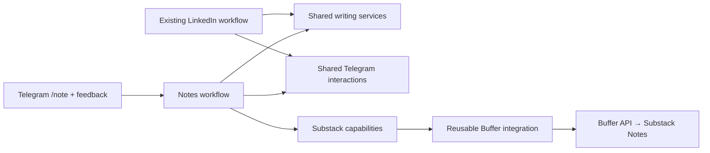
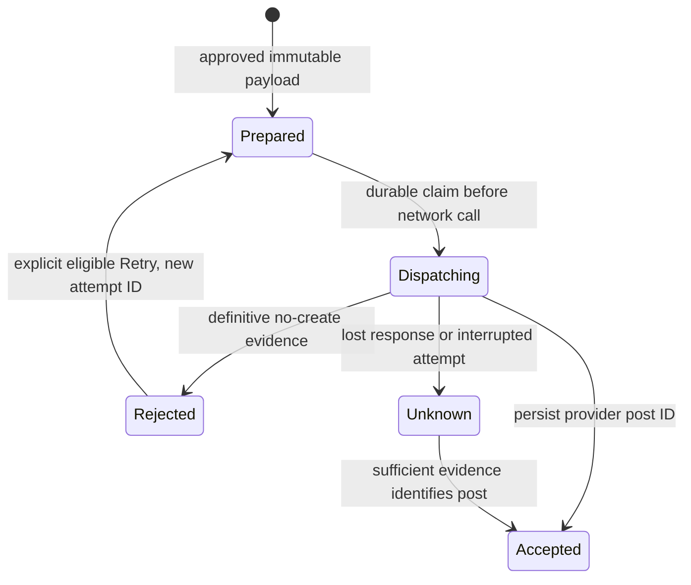
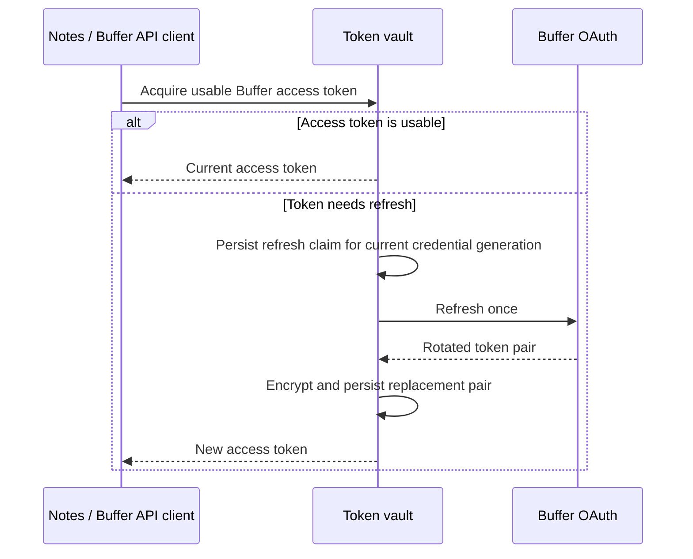

# Technical design: Substack Notes through Buffer

Inputs: [approved PRD](04-prd-substack-notes-buffer.md), [research](03-research-substack-notes-buffer.md), and [request](01-request-substack-notes-buffer.md). Product scope includes optional Buffer queue placement, exact-time scheduling and OAuth recovery; optional core-ideation remains a follow-up.

## System Design

### A Notes workflow uses shared writing services and a reusable Buffer integration

**Agreed by the author on 10 November 2026.** Add a dedicated durable Notes workflow. It owns the Notes execution: raw thoughts, clarification, drafting, revision, exact-content/timing approval, and Buffer submission. Shared writing services handle prompt resolution, bounded model execution, transcript persistence, and usage reporting. Shared Telegram services continue to handle notification and routing.

Keep Buffer OAuth, channel discovery, API calls, provider errors, and submission-result interpretation in a reusable integration. A Substack-specific capability layer validates text and optional link-card support. A future channel can reuse the Buffer integration while supplying its own capabilities.



The writing-services node is a proposed reuse boundary, not a claim that a generic writing module already exists. LinkedIn currently composes shared runtime helpers with LinkedIn-specific agent/prompt code and directly owns Notion orchestration. Extract narrowly useful helpers with equivalent LinkedIn behavior; do not make Notes depend on that Notion lifecycle. LinkedIn continues to create LinkedIn drafts through its existing integration.

A generic configurable publishing-workflow engine is the alternative. It could consolidate more orchestration, but introduces policy/configuration machinery before a second Buffer-backed workflow exists and couples this feature to a broader LinkedIn migration. Recommend the dedicated workflow with shared components.

The same Notes execution owns submission through Buffer acceptance. The publication guard preserves mutation evidence; downstream publication belongs to Buffer.

System Design approved by the author on 10 November 2026, with the instruction to proceed to Program Design. Successful Buffer acceptance ends Kipp's responsibility; no post-acceptance publication polling or link retrieval is required.

### Kipp completes when Buffer accepts the approved request

**Clarified by the author on 10 November 2026.** Keep review and submission in the same durable Notes execution. Submit the exact approved Note immediately with immediate-publication mode, approved next-available queue placement or the approved exact future due time. On a valid Buffer mutation success, persist its post ID/result, notify Telegram and finish. Buffer owns subsequent publication, scheduled execution, channel failures and the eventual Substack link.

For immediate publication, say “Sent to Buffer for publication.” For queue placement, confirm “Added to your Buffer queue” and the assigned due time when returned. For an exact schedule, confirm the accepted date/time/zone. Include a returned link only when available in that response; do not require a Substack link for completion. An HTTP 200 alone is insufficient: validate the typed mutation payload and requested outcome, including scheduled due time. An unexpected draft/approval-required outcome must not be presented as successful automatic publication setup.

```mermaid
stateDiagram-v2
  [*] --> Review
  Review --> Approved: exact-content/timing approval
  Approved --> Submit: close review controls
  Submit --> Accepted: valid Buffer mutation success
  Accepted --> [*]: notify author; Buffer owns publication
  Submit --> Rejected: definitive no-create evidence
  Rejected --> Submit: explicit eligible Retry
  Submit --> Unknown: lost or ambiguous response
  Unknown --> Accepted: sufficient evidence of accepted request
```



There is no sleep until scheduled time, routine status polling, delayed-link retrieval, delivery deadline, later publication notification or automatic recovery of a Buffer-accepted post. The proposed 24-hour/100-read tracking policy is removed. Shared Buffer code remains reusable; no separate delivery workflow or cron is introduced.

Unknown submission is a different case from downstream publication. If the create response is lost, preserve the dispatch evidence and do not blindly create again. Limited reconciliation can establish acceptance when evidence is sufficient; otherwise report that submission could not be confirmed, preserve the record and finish. The author can decide whether to copy the approved text from Telegram into Substack or Buffer; no inspection-and-retry interaction is required. Exact bounded reconciliation mechanics belong in Program Design, without introducing an ongoing publication tracker.

### One durable record guards each approved publication

**Agreed by the author on 10 November 2026.** Add a Buffer publication Durable Object, keyed by a stable publication ID derived from the Notes execution. It owns the approved payload and create-attempt evidence; the Notes Workflow continues to own user interaction, submission and its acceptance notification. This is a mutation guard, not another delivery workflow or polling service.

Persist the exact approved text, optional URL, Buffer connection/account/channel identity, timing, review version and approval evidence. Bind the stable publication ID to that immutable payload; a replay with a different payload is rejected. Keep working writing transcripts in workflow state. No credentials belong in the publication record.

Before the first network create, atomically move a prepared attempt to dispatching and durably record its attempt ID. Only the invocation winning this transition may send that attempt. A replay that finds dispatching/unknown must reconcile rather than send another create. Preserve the provider post ID and result when available; a persisted accepted result is returned on replay even if the Workflow checkpoint was lost.



If Kipp stops after writing dispatching but before sending the request, it may conservatively leave a Note unposted. That is preferable to duplicating a possibly accepted Note. Neither a timeout/expired lease nor an empty Buffer search proves that a create was never sent. Do not automatically free the record to send again. A matching text/time alone is not a unique operation identity; ambiguous candidates remain unknown.

A definitive pre-create rejection permits a separately authorized Retry of the unchanged payload before the review deadline and scheduled due time. Each retry has its own durable attempt identity. An existing Buffer post cannot return to the new-create path. Once accepted, later publication failure/retry is Buffer's responsibility. Store submission-evidence updates with attempt/version checks so late responses cannot overwrite an accepted result.

The Workflow's own checkpoint is insufficient at this boundary: the external create can succeed before that checkpoint is saved. The guard still cannot make the public Buffer API exactly-once. It makes replay conservative by preserving intent before the request and refusing blind repeat creates. Exact atomic transitions, interrupted-request handling, reconciliation evidence and recovery tests must be settled in Program Design.

| Storage option | Tradeoff |
| --- | --- |
| One publication Durable Object (recommended) | Fits existing Kipp per-resource coordination; isolates claims and evidence by publication without using the meal-planning database. Adds one binding/class and append-only migration. |
| Dedicated D1 publication table | Conditional updates can provide the same guard; useful for cross-publication queries, but adds database provisioning and a table-based claim protocol. |
| Workflow checkpoints alone | Simpler, but do not retain the pre-send guard independently of a lost mutation-step checkpoint. |

### The existing encrypted token vault owns Buffer OAuth

**Agreed by the author on 10 November 2026.** Add Buffer as a provider in Kipp's existing token-vault boundary. Keep token acquisition and rotating refresh inside that boundary rather than letting each workflow refresh credentials independently. Reuse existing encryption, setup access checks and provider isolation. Existing LinkedIn and Calendar token behavior must remain equivalent.

Use one configured Buffer connection initially, shared by Notes executions and later Buffer-backed channels. Channel selection is separate from credential storage. Reauthorization to the same Buffer account may replace tokens without changing the approved destination; a different account/channel cannot inherit an existing approval.



Concurrent callers join the same live refresh or wait for its result; they never independently reuse its refresh token. Persist a credential generation and refresh-in-progress marker before sending the refresh request. Persist both replacement tokens before releasing the result. A late refresh response cannot overwrite tokens from a newer successful authorization.

If refresh has an uncertain outcome after interruption, do not blindly replay the old single-use token. Mark the connection as needing reauthorization. An expired access token with a usable refresh token remains a silent repair; missing/revoked authorization or unusable refresh prompts Connect Buffer, then explicit Retry for an eligible approved write. Read-only reconciliation of an uncertain submission may resume with repaired credentials without authorizing a new create; accepted posts need no further observation. Transient failures proven not to have consumed the refresh token can be retried within bounds; otherwise remain conservative.

Register a server-side Buffer OAuth client with PKCE, single-use state bound to the setup cookie and a fixed allowlisted callback. Keep the verifier and tokens server-side. Request account:read, posts:read, posts:write and offline_access; unrelated write/analytics permissions are unnecessary. Setup and recovery distinguish Kipp-to-Buffer authorization from Buffer's own Substack connection.

An independent Buffer credential store/DO could isolate this feature further, but duplicates an existing encrypted credential boundary. Recommend extending the vault with Buffer-specific coordination and regression coverage. Current vault storage alone is insufficient: it has no refresh coordination or PKCE verifier state. [Buffer OAuth and rotation requirements](https://developers.buffer.com/guides/building-apps.html).

### Versioned candidates and explicit action tokens bind review authority

**Agreed by the author on 10 November 2026.** Reuse the per-chat interaction router's groups/versions, but have the Notes Workflow independently validate every approval. Router consumption alone is not publication authority.

Each review candidate binds its exact text, optional link, destination identity and normalized timing to a monotonically increasing version and a content fingerprint. Its Publish/Add to queue/Schedule and Revise buttons use opaque action tokens registered for that execution/version. The Workflow retains the expected interaction IDs, owner, deadline and candidate fingerprint. Incoming events must match that pending state and the allowed action kind; arbitrary text such as “publish”, model output or internal-looking text markers cannot authorize publication.

```text
Review authority
  execution + owner/chat
  candidate version + payload fingerprint
  allowed interaction IDs and action kinds
  fixed review deadline + current phase

Approved publication
  exact candidate payload + fingerprint
  approving owner + interaction/update identity + approval time
```

Any content, link, destination or timing change creates a new candidate/version and invalidates older controls. When actual revision starts, invalidate approval for the previous candidate before running the model. A Revise tap alone asks for feedback without generating or spending a generation; the current text may remain approved for review until feedback starts replacement. If replacement fails, preserve the last valid text and reoffer it with fresh controls under a new version before accepting approval. This keeps the revision-budget guarantee without allowing an old button to approve intervening work.

Approval transitions the Workflow out of review and prepares the immutable publication record. Replayed/sibling actions cannot authorize a second operation; the publication guard enforces the same payload even if that durable step is replayed. Retry has a separate action identity tied to the rejected attempt, unchanged payload and remaining eligibility; reconnecting does not synthesize approval.

Use Notes-specific interaction kinds for command dispatch and action validation. Keep the existing shared router behavior for other workflows and the documented single-active-feedback-conversation limitation. This does not implement concurrent feedback support or repair LinkedIn's older-version approval gap.

One current transport caveat must be handled in Program Design: the router consumes an interaction before sending its event to the Workflow. A failed send must not be treated as successful approval. Recovery may redeliver the same authenticated event or reoffer current controls after checking Workflow state; it must never manufacture approval or duplicate a write. Specify and test the exact Notes recovery path.

The alternative is relying only on router consumption/version invalidation. It leaves the final writer dependent on router bookkeeping and cannot bind a received event to the exact payload independently. Recommend both routing checks and Workflow-owned candidate validation.

### Structured scheduling stays outside the writing prompt

**Agreed by the author on 10 November 2026.** Treat the Note text and publication instructions as separate fields. A bounded model session may interpret a natural-language scheduling request, but deterministic code validates the proposed date/time/zone, converts it to a UTC instant, and renders the approval summary. The author-style prompt controls prose; it cannot grant approval, change provider operations, or replace the timing contract. This boundary does not require an extra model call for every draft.

At a new invocation, no scheduling request means immediate publication. An explicit queue request proposes next-available Buffer placement. During revision, no timing change means preserve the existing mode and exact time if any; an ordinary rewrite must not turn a scheduled Note into an immediate Note. A request to “publish now” changes the proposal and requires the explicit Publish action.

Reuse the existing TIMEZONE configuration as the default for omitted zones, snapshotting it for the run. An explicit user zone takes precedence. If neither exists, ask for a zone when exact-time scheduling is requested; do not inherit Calendar's hard-coded Asia/Kolkata fallback or infer the server timezone. Immediate and queue-only runs need no timezone setup. Buffer uses its channel posting schedule to select a queue slot.

```text
Timing proposal
  now OR queue
  OR local date + local time + IANA zone + source request reference

Validated timing
  now OR queue (Buffer assigns the slot)
  OR UTC dueAt + review date/time/zone
```

For queue mode, render “Timing: Next available Buffer slot” and an Add to queue approval button. Do not calculate or promise a due time before submission. The model interprets explicit intent into a structured mode; vague timing or competing queue/exact-time instructions yield clarification. Mode changes require fresh approval; the configurable prose prompt cannot set a different default.

Resolve relative dates against the persisted receipt time of the message containing that timing request, not the model's current clock or the first draft's generation time. Persist that reference so replay cannot shift “tomorrow”. Snapshot each resolved time; rephrasing the Note alone does not recalculate it.

Ask about vague wording, ambiguous zone abbreviations, and nonexistent/ambiguous daylight-saving local times. Validate future eligibility at review approval, retry, and immediately before dispatch. A past time must not become shareNow automatically. If transport delay prevents meeting the approved time, report the result and request new authority rather than silently schedule a different time.

Show the exact text separately from the optional attached URL and publication timing. Hash the normalized timing with the other approved fields. UTC conversion is an implementation detail; the author reviews an absolute local date/time and zone.

The alternative is a rigid schedule flag/date syntax. It is easier to parse but adds user-facing command syntax despite the approved natural-language interaction. Recommend structured proposals plus deterministic validation and explicit review. Program Design will specify schemas and timezone conversion, including daylight-saving checks; existing Calendar date helpers require review before reuse.

## Program Design

**Approved by the author, 10 November 2026.** The author approved the module boundaries, shared time utilities with straightforward Calendar fixes, commentary → timing → Note presentation, five writing sessions, and first-URL-only attachments. The author chose manual Buffer channel-ID configuration, matching LinkedIn. The contracts below complete those choices; the author approved the whole Program Design with “प्रोग्राम design approved. Please continue”. The subsequent time spike recommends Luxon 3.7.2 behind the approved interface; production adoption remains implementation work.

### A thin entrypoint delegates to domain modules and existing services

```text
src/notes/
  workflow.ts          NotesWorkflow and invocation parameters
  runner.ts            durable session/review/submission orchestration
  types.ts             domain schemas and persisted state
  review.ts            candidate fingerprints and action authority
  timing.ts            publication-time validation and merge policy
  links.ts             first-link extraction from text + Telegram entities
  telegram.ts          commentary, timing, attachment and exact text rendering
  prompts/defaults.ts  bundled Notes writing fallback
src/agent/notes.ts     bounded native-tool writing session
src/writing/prompt-resolver.ts
src/core/feedback-session.ts
src/core/time.ts
src/core/buffer-publication.ts
src/core/buffer-publication-client.ts
src/integrations/buffer/
  client.ts            fixed GraphQL operations and response decoding
  types.ts             provider transport/result contracts
  oauth.ts             code exchange and refresh transport
  substack.ts          text/card capabilities and provider input mapping
src/triggers/buffer-auth.ts
```

Move the existing GitHub prompt resolver and LinkedIn feedback-deadline helpers to the shared locations, preserving re-exports at their current paths. Reuse core/conversation.ts, core/cost.ts, runtime/tool-runner.ts, runtime/agent-session.ts and existing Telegram/client factories. LinkedIn retains its Notion lifecycle, agent, output schema and draft integration. No generic publishing engine or LinkedIn Buffer migration is introduced.

```text
Telegram webhook
  authenticate sender → parse /note and original message entities
  startNotesWorkflow(stable invocation ID)
    NotesWorkflow.run → runNotesWorkflow
      snapshot configuration, prompt, receipt anchor and destination
      bounded writing session → validate proposal
      render review → wait → validate exact action
      freeze approved publication
      BufferPublicationDO.submit
        preflight auth/destination/time → durable dispatch claim
        BufferClient.createPostOnce → persist result
      notify acceptance or actionable failure → finish/wait for eligible Retry
```

Add optional plain-text and link-preview controls to the Telegram client, preserving Markdown as the existing default for other callers. Notes sends exact draft text with parse mode omitted and previews disabled, so Markdown-looking characters cannot change the reviewed text. Split without trimming or breaking surrogate pairs; concatenating the Note chunks must reproduce the approved text exactly. Do not reuse LinkedIn's newline-trimming chunker for this contract.

The runner receives a clock and factories for provider, prompt source, Telegram, router, vault and publication guard. Production uses real factories; tests supply controlled services. Durable effects stay inside named step.do calls; time used for decisions is captured in those calls rather than recalculated during replay.

### Invocation and event schemas retain identity and original link information

```ts
interface NotesWorkflowParams {
  chatId: string
  userId: string
  telegramUpdateId: number
  telegramMessageId: number
  receivedAtMs: number
  rawThoughts: string
  firstLink: InputLink | null
  setupOrigin?: string
}

interface InputLink {
  url: string
  label?: string
  sourceMessageId: number
  offset: number
  length: number
}

type NotesActionKind =
  | "notes-publish" | "notes-queue" | "notes-schedule" | "notes-revise"
  | "notes-feedback" | "notes-clarification" | "notes-retry"

interface NotesInteractionEvent {
  deliveryId: string
  workflowId: string
  chatId: string
  userId: string
  telegramUpdateId: number
  telegramMessageId?: number
  receivedAtMs: number
  interactionId: string
  interactionVersion: number
  interactionKind: NotesActionKind
  text?: string
  firstLink?: InputLink | null
}
```

Use a deterministic invocation ID, notes- plus SHA-256 of a versioned tuple containing chat/message identity. On an uncertain Workflow create response, look up that same instance; never create a fresh ID. Reuse the create-or-get behavior of core/edit-workflow.ts through a neutral helper rather than retaining an edit-specific name for Notes.

Validate request and event objects at runtime. Enforce the allowed user before routing; persist the owner independently in the Workflow. Use Notes-specific interaction kinds and dispatch them to NOTES_WORKFLOW. Plain text can supply feedback/clarification but cannot approve or retry. Callback text markers are never authority.

Extract the first HTTP(S) destination from the original message before removing the command. Merge url/text_link entities with literal-URL fallback on uncovered text, sort by original UTF-16 offset and take the first valid candidate. For a masked link, preserve its actual target and optional label. Validate entity bounds; JavaScript string slicing matches Telegram's offset units. Retain query strings and fragments. Later URLs do not become cards or inline parenthesized links. No URL selection or confirmation state exists. No article fetch is performed.

Feedback uses the same entity-aware extraction, but an incidental URL never silently replaces the current attachment. Explicit attachment-change intent can propose use-first-link or remove; the runner chooses the actual author-supplied URL, not a model-invented one. Any change goes through fresh review.

### The writer hands back structured proposals, never publication authority

```ts
type ProposedDate =
  | { kind: "absolute"; localDate: string }       // YYYY-MM-DD
  | { kind: "relative-days"; days: number }       // source receipt's local date

type TimingInstruction =
  | { kind: "unchanged" }
  | { kind: "now" }
  | { kind: "queue" }
  | { kind: "schedule"; date: ProposedDate; localTime: string;
      timeZone?: string }

type AttachmentInstruction =
  | { kind: "unchanged" }
  | { kind: "use-first-input-link" }
  | { kind: "remove" }

type NotesWritingResult =
  | { kind: "draft"; commentary: string; text: string;
      timing: TimingInstruction; attachment: AttachmentInstruction }
  | { kind: "clarification"; question: string }
```

Implement strict Zod schemas and one isolated native-tool handoff, submit_notes_response, returning draft or clarification. No network, credential or publication tools are exposed. Commentary/question is bounded at 1,500 characters. Nonempty Note text has a 10,000-character provider ceiling; prompt guidance targets much shorter Notes, not the maximum. Review rendering handles longer valid results without silently truncating approved text. Provider-specific length checks live in substack.ts and count the actual plain text; any provider rejection remains a typed result.

Snapshot the configured PROMPT_NOTES_PATH → notes-style-prompt.md → bundled fallback using the shared resolver. Only missing files fall through; other GitHub failures propagate. Store prompt content/source/SHA once, along with model selection, TIMEZONE and the initial receipt anchor. Do not inherit LinkedIn's word template. Keep the fixed tool/authority instructions separate from configurable audience/voice instructions. Detailed editorial examples remain deferred.

Persist runTools messages via persistableAgentMessages and assertStepOutputSize. Reuse its three-provider-turn/four-tool-call session bounds and existing bounded provider transport retries. Count at most five logical writing sessions: initial plus four clarification/revision sessions. Dispatched failures consume a slot; Revise taps, deterministic checks and OAuth recovery do not. Session steps use stable names writing-0 … writing-4, no automatic application-level generation retry, and retries.limit = 0 at the Workflow step layer. Convert ordinary generation failures into persisted failure results; propagate actual Workflow interruption signals.

The five-session limit is a logical drafting budget, not an exactly-five-HTTP-requests guarantee: provider retries occur inside a session and a runtime interruption before its result checkpoint can repeat a model call. Do not add another coordination store solely for exact LLM billing. Such replay never authorizes a Buffer mutation. Tests verify the five-slot loop and absence of automatic error retry; actual runtime interruption behavior is documented rather than hidden.

```ts
interface NotesRunState {
  schemaVersion: 1
  owner: { chatId: string; userId: string }
  deadlineMs: number
  prompt: { content: string; source: string; sha?: string }
  model: string
  defaultTimeZone?: string
  destination: BufferDestination
  nextSession: number                 // 0..5
  candidateVersion: number
  messages: ToolConversationMessage[]
  candidate: ReviewCandidate | null
  usage: LLMUsage
  processedDeliveryIds: string[]
}
```

This is the logical state reconstructed from Workflow step outputs, not a second full transcript database. Keep the last valid candidate on failure. If the final session returns a clarification with no remaining generation slot, do not pretend another drafting turn is available: reoffer the previous valid candidate if there is one, or explain that a new execution is needed. On exhaustion, offer fresh approval controls for that candidate until the fixed deadline; otherwise explain that no valid draft was produced and finish. Necessary meaning clarification uses the same writing budget. The fixed deadline uses existing LinkedIn semantics without resetting on feedback/reconnect.

For later ideation, accept an explicit DraftSource containing originalThoughts, optional authorConfirmedIdea/supportingDetails and the first approved URL. Construct a fresh drafting conversation using the independent Notes prompt; do not splice ideation system instructions into it. The current trigger supplies only original thoughts. No ideation mode or generic skill loader is implemented.

### Candidate state binds buttons to exact content and timing

```ts
type PublicationTiming =
  | { kind: "now" }
  | { kind: "queue" }
  | { kind: "scheduled"; dueAt: string; localDate: string;
      localTime: string; timeZone: string }

interface BufferDestination {
  connectionId: string                 // stable account identity, not token generation
  accountId: string
  organizationId: string
  channelId: string
  service: "substack"
}

interface ReviewCandidate {
  version: number
  text: string
  commentary: string
  attachmentUrl: string | null
  timing: PublicationTiming
  fingerprint: string
  actions: Array<{ interactionId: string; kind: NotesActionKind }>
}
```

Fingerprint a versioned canonical tuple of exact text, attachment URL-or-null, account/organization/channel identity and normalized timing. Queue timing fingerprints its queue mode, not a speculative slot; the provider-assigned dueAt is result evidence and never changes the approved fingerprint. Commentary and display decoration are not published fields. Store UUID action/callback tokens inside checkpointed preparation steps so replay never invents another set.

Use separate review and feedback interaction groups for each Notes execution. Extend router registration with optional owner metadata and an explicit group/version invalidation operation used by Notes only. Every change or replacement start invalidates prior publication authority before generation. A Revise tap prompts for feedback without generating; direct reply works too. On failed replacement or budget exhaustion, reoffer the last valid candidate under a new version. Prepare the current action IDs and register callback tokens before sending their visible buttons. After sending, bind the returned message IDs for direct replies; replay uses the same tokens/version. Router reply lookup must prioritize notes-feedback/notes-clarification for Notes messages while retaining existing non-Notes priority. Before freezing, check owner/chat, execution, phase, exact version, expected ID/kind, fixed deadline and current candidate fingerprint.

Use three phases in the runner: writing/clarifying, review, and approved-submission. Review edits are closed after approval. Retry is a separate Notes action bound to one definitively rejected attempt and unchanged payload. After acceptance, no interaction restarts publication.

Render commentary first, then timing and optional “Attached link: URL”, then exact Note text and Publish/Add to queue/Schedule + Revise controls. Disable accidental link previews on commentary/attachment-display messages if needed to avoid implying an exact card preview. Long Notes are split losslessly across Telegram messages with controls attached to the final Note segment; explicit replies to any registered segment route to the same current feedback group. All segments refer to one candidate. A notification retry can duplicate a Telegram message; it cannot duplicate a Buffer create.

### Retaining authenticated Notes events fixes consume-before-forward loss

Keep existing LinkedIn/Calendar/meal behavior. For Notes, add a small delivery table to InteractionRouterDO alongside its routing index:

```sql
CREATE TABLE IF NOT EXISTS notes_deliveries (
  delivery_id TEXT PRIMARY KEY,
  telegram_update_id INTEGER NOT NULL UNIQUE,
  interaction_id TEXT NOT NULL,
  workflow_id TEXT NOT NULL,
  envelope_json TEXT NOT NULL,
  expires_at INTEGER NOT NULL,
  acknowledged_at INTEGER
);
CREATE INDEX IF NOT EXISTS notes_delivery_action
  ON notes_deliveries(interaction_id);
```

```text
authenticated webhook
  resolveNotesAndRemember
    atomically consume current interaction and retain immutable event
    on same update: return the same event
  sendEvent(type = "notes-interaction", payload = retained event)
  acknowledgeDelivery(deliveryId)
  return HTTP 200

sendEvent/ack failure → HTTP 503 → allow Telegram webhook redelivery
redelivery after acknowledgment → HTTP 200, no new action
```

The original user/chat/text/link data and receipt time are captured once. Delivery replay never re-resolves the update against a newer candidate. Cache entries live until the review deadline plus the router's existing one-hour consumed-interaction grace; cleanup is lazy with router access. No cron, delivery tracker or new long-lived transcript store is introduced.

The Workflow remembers processed delivery IDs in its checkpointed transitions; duplicate enqueues are harmless. A sendEvent success means transport acceptance, not proof that publication occurred. If acknowledgment is lost, resending the same authenticated event is safe. If the callback is tapped again under a new update ID while delivery is pending, reuse the pending delivery for that same action; never create fresh authority. After acknowledgment, sibling/replayed controls remain consumed/stale. An outage lasting through expiry cannot create late approval; the user may need a new execution.

Add Notes kinds to direct-reply/plain-text routing without changing the documented unsupported concurrent-feedback behavior. Router invalidation plus Workflow validation remain both necessary. Do not implement general cross-workflow ambiguity handling or fix the tracked LinkedIn stale-approval issue here.

### A single-shot Buffer client separates read retry from create retry

```ts
interface BufferCreateCommand {
  destination: BufferDestination
  text: string
  attachmentUrl: string | null
  timing: PublicationTiming
}

type BufferCreateResult =
  | { kind: "accepted"; postId: string; dueAt?: string; link?: string }
  | { kind: "created-unexpected"; postId: string; reason: string }
  | { kind: "rejected"; reason: string;
      repair: "reauthorize" | "reconnect-channel" | "configuration" | "later" | "none" }
  | { kind: "unknown"; reason: string }

interface BufferClient {
  discoverDestination(channelId: string): Promise<BufferDestination>
  createPostOnce(command: BufferCreateCommand): Promise<BufferCreateResult>
}
```

Keep provider queries/variables/decoders static and runtime-validated. No broad GraphQL engine or SDK is required. Discovery uses account/organizations/channels and validates the configured channel's service, organizationId, allowedActions (including scheduleUpdates), isDisconnected and isLocked. Also inspect isQueuePaused and surface paused-queue setup/preflight diagnostics; never unpause a user's queue automatically. Require Substack plus active usable publishing authority; never substitute the first discovered channel. A need for approval must not be downgraded into draft creation. Recheck account/channel identity at submission after credential repair.

Substack capability mapping produces:

```ts
{
  channelId: approved.destination.channelId,
  text: approved.text,
  assets: [],
  schedulingType: "automatic",
  mode: approved.timing.kind === "now" ? "shareNow"
    : approved.timing.kind === "queue" ? "addToQueue" : "customScheduled",
  needsApproval: false,
  saveToDraft: false,
  // dueAt only for customScheduled
  // metadata.substack.linkAttachment.url only when attachment exists
}
```

The strict queue instruction contains no date/time/dueAt; mixed queue/exact-time fields are invalid. Queue mode omits dueAt in the request. Buffer assigns the next available channel slot. Validate returned shareMode and automatic, non-draft/non-approval outcome against queue intent, without comparing dueAt to a Kipp-calculated slot. Persist any assigned dueAt in the accepted result. On successful queue placement, the Telegram confirmation must display that returned posting date and time in the run’s known display zone, or explicitly UTC if no zone is known. Render the same persisted result on replay without another create. If Buffer omits dueAt, confirm successful queueing without inventing a time or triggering polling. A returned post in an unexpected mode remains created-unexpected with no new create.

Decode __typename, known mutation errors and post evidence. Request post ID, channelId/channelService/text/status, shareMode (the output name, unlike input mode), nullable schedulingType, isCustomScheduled/sharedNow, dueAt and nullable externalLink. For cards, select metadata through the SubstackPostMetadata fragment with linkAttachment { url expandedUrl }. Validate only documented fields and preserve output nullability. Preserve any returned post ID before interpreting an unexpected result. Do not require sent status or a public Substack URL. An existing unexpected draft/approval-required post is reported for manual inspection and must never authorize another create.

Read operations may retry twice with bounded backoff and an explicit network deadline. A create uses one HTTP request with a 20-second AbortSignal timeout and no hidden retry middleware. A timeout, network interruption, malformed payload, server error or unknown GraphQL error is unknown unless typed evidence proves rejection before creation. HTTP status alone is not enough to grant Retry. Recognized validation/authorization errors permit repair only when their contract establishes no post was created; unknown errors remain conservative. The contract spike found no blanket rollback guarantee for InvalidInputError, UnauthorizedError, NotFoundError or LimitReachedError. Default those to unknown unless a narrow verified pre-create rule applies; local preflight failures remain definitive no-create. Select __typename plus MutationError.message, rather than deprecated RestProxyError-specific fields. Synthetic fixtures demonstrate decoder policy, not actual Buffer responses. Keep provider error prose and token material out of logs.

A future Buffer channel supplies its capability validator and metadata mapper; OAuth, transport, identity, error handling and mutation guard remain reusable. This release registers only Substack.

Sources for provider contracts: [creation input](https://developers.buffer.com/types/CreatePostInput.html), [scheduling](https://developers.buffer.com/guides/posts-and-scheduling.html), [read/write retry distinction](https://developers.buffer.com/guides/efficient-api-usage.html).

### The publication Durable Object owns the network boundary

```ts
interface ApprovedPublication {
  publicationId: string
  workflowId: string
  candidateVersion: number
  fingerprint: string
  command: BufferCreateCommand
  approval: { userId: string; chatId: string; deliveryId: string;
    interactionId: string; approvedAtMs: number }
  deadlineMs: number
}

interface PublicationRecord {
  approved: ApprovedPublication
  state: PublicationState
}

type PublicationState =
  | { phase: "prepared"; attempts: number }
  | { phase: "dispatching"; attemptId: string }
  | { phase: "accepted"; postId: string; result: BufferCreateResult }
  | { phase: "created-unexpected"; postId: string; reason: string }
  | { phase: "rejected"; attemptId: string; reason: string; repair: string }
  | { phase: "unknown"; attemptId: string; postId?: string; reason: string }
  | { phase: "superseded" }
```

Use BUFFER_PUBLICATIONS.idFromName(publicationId), with publicationId derived from Workflow identity and approved candidate version. One immutable payload belongs to each approved publication. The DO exposes prepare, submit, retryRejected, inspect and supersedeRejected operations through a typed client. These internal APIs require exact fingerprint/attempt/authority matches and have no public HTTP route. They never accept a model-supplied grant.

Store one versioned record and append attempt evidence in the DO SQLite database:

```sql
CREATE TABLE IF NOT EXISTS publication (
  id INTEGER PRIMARY KEY CHECK (id = 1),
  schema_version INTEGER NOT NULL,
  fingerprint TEXT NOT NULL,
  revision INTEGER NOT NULL,
  record_json TEXT NOT NULL
);
CREATE TABLE IF NOT EXISTS attempts (
  attempt_id TEXT PRIMARY KEY,
  ordinal INTEGER NOT NULL UNIQUE,
  state TEXT NOT NULL,
  started_at INTEGER NOT NULL,
  result_json TEXT
);
```

Use a local storage transaction for each record/attempt transition, with revision and expected-phase checks. Result/error fields are sanitized structured evidence, not arbitrary provider response dumps. Keep superseded fingerprints and attempts immutable.

```text
submit
  read immutable approved record
  accepted/created-unexpected/superseded → return durable result; never send
  dispatching/unknown → return uncertainty; never acquire another send lease
  prepared → acquire credentials and validate destination + current due time
  atomic compare-and-set prepared → dispatching(attempt ID)
  winning invocation alone sends createPostOnce
  persist result using attempt/fingerprint checks → return
```

Perform storage transitions atomically without holding a storage transaction across network I/O. The DO itself sends the request after winning the claim, so a caller cannot retain a stale claim and send later outside the guard. A live in-memory submit promise can let concurrent callers join; persistent state remains the authority after eviction. No alarm or lease expiry releases dispatching to prepared.

Persist a provider post ID/result whenever available. Workflow replay reads that result even if its own submit checkpoint was lost. A result write that temporarily fails may be retried with the same observed response in memory; it must not resend create. An interruption before evidence is stored leaves dispatching/unknown.

The author chose a simple terminal failure for an unresolvable submission result. Report “I couldn't confirm submission to Buffer. The Note may already have been received; Kipp hasn't sent another attempt.” Keep the approved text visible in Telegram. The user independently decides whether to copy it into Substack or Buffer. Do not require inspection, wait for an inspection result, or offer an override/recreate action. The existing LinkedIn implementation has the same class of uncertainty: its createDraftPost call has no Kipp mutation guard or lost-response reconciliation, and generic failure is treated as publish-failed. Notes publishes publicly, so the proposed design is more conservative about retrying. This is a reliability improvement over current LinkedIn behavior, not proof that LinkedIn already handles the case safely. Known rejection still uses repair/Retry; valid success still completes immediately.

Reconciliation is deliberately small: inspect the durable guard once; if a trustworthy post ID was already captured but the response was incomplete, perform one bounded read of that exact ID to validate acceptance. Without such an ID, stop at unknown and send the terminal failure notification. Do not prescribe a manual inspection procedure or wait for further recovery input. No fuzzy text/time search establishes unique identity; no search result establishes non-creation. There is no downstream publication polling.

A definitive no-create rejection may authorize up to two explicit retries (three attempts total) within the original deadline and, for schedules, before dueAt. OAuth repair alone never changes prepared/rejected to dispatching. Each Retry action has a fresh ID and is consumed atomically against the rejected attempt. An authorization failure before dispatch is persisted as no-create evidence and can use the same repair flow. Queue Retry retains queue intent and therefore uses the next available slot at that eligible submission, not a previously estimated slot. Only exact-time schedules have a dueAt eligibility cutoff; all modes retain the review deadline, identity and no-create evidence requirements.

If a rejected schedule needs a new time, atomically seal the old guard as superseded before offering changed content/timing for fresh approval. Only prepared/rejected records with definitive no-create evidence may be superseded; accepted, dispatching, unknown and created-unexpected records cannot. Fresh approval creates a new publication ID/version, retaining old attempt evidence. This lets the author repair elapsed timing without making an old Retry button live again.

The accepted path persists the outcome, confirms “Sent to Buffer for publication”, “Added to your Buffer queue” (assigned time when returned), or the accepted exact schedule, includes a link only if already returned and finishes. Unexpected-created/unknown paths preserve evidence, explain the outcome and finish with no publishing Retry or manual-inspection continuation. A failure to confirm is not a claim that no Note exists in Buffer. Buffer owns all activity after valid acceptance.

Publication evidence has no automatic deletion timer in this release; deleting it could permit duplicate replay. Writing transcripts stay in Workflow state under existing conventions. Do not add a special content-retention cleanup or log raw thoughts, approved text, links or credentials.

### Buffer OAuth extends the existing encrypted vault with provider-specific coordination

Use the existing singleton TokenVaultDO and encryption envelopes. Add TOKEN_PROVIDER.BUFFER and Buffer-specific operations rather than exposing Buffer refresh tokens to workflows.

```ts
interface BufferGrant {
  accessToken: string
  refreshToken: string
  expiresAtMs: number
  accountId: string
  credentialGeneration: number
  scopes: string[]
}

type BufferAccess =
  | { kind: "usable"; accessToken: string; accountId: string;
      credentialGeneration: number }
  | { kind: "needs-auth"; reason: string }

// Proposed client methods:
issueBufferState(): Promise<{ state: string; cookieId: string; challenge: string }>
consumeBufferState(state: string, cookieId: string):
  Promise<{ valid: false } | { valid: true; verifier: string; redirectUri: string }>
acquireBufferAccess(): Promise<BufferAccess>
replaceBufferGrant(grant: BufferGrant): Promise<void>
```

Keep PKCE verifier state encrypted with the existing key mechanism and delete it atomically on valid consumption. State/cookie lifetime is five minutes. Callback consumes state before the one-time code exchange; an interrupted exchange requires starting Connect Buffer again. Generate S256 with Web Crypto; cookie is Secure, HttpOnly and SameSite=Lax. Never reflect an arbitrary request Host into the redirect URI.

Expose GET /setup/buffer and GET /auth/buffer/callback in index.ts. Reuse hasSetupAccess for setup and existing callback access/cookie protections. BUFFER_REDIRECT_ORIGIN defines the fixed callback origin. After code exchange, read account identity and verify required scopes before persisting the grant. The setup result reports connection status and the configured channel validation; if absent, list discovered channel names/IDs for manual configuration. Do not add a channel chooser. Tokens never appear on the setup page.

Use auth.buffer.com/auth and /token, and account:read posts:read posts:write offline_access. Read the same Buffer grant for later channels; channel identity is separate configuration.

Refresh when the token has less than 60 seconds remaining. Serialize Buffer refresh through a provider-local in-memory promise plus a persisted generation/claim token. Set the promise before yielding, persist the claim before network dispatch, then atomically store both rotated tokens only if the generation/claim still matches. Concurrent callers join the live promise. Other providers need not wait on Buffer network requests. On restart, an abandoned persisted refresh claim means needs-auth, not permission to replay the old refresh token. OAuth replacement increments the generation, fencing late refresh responses. A lost/ambiguous refresh response requires reauthorization.

Keep connectionId stable across same-account reauthorization, distinct from credentialGeneration. A different account changes connectionId, so an old candidate/approval fails destination identity checks. Never retarget an approved channel after reauthorization. Missing configured channel or Buffer-to-Substack disconnection asks for the relevant repair, not a different account.

Reconnect uses Connect Buffer + explicit Retry, with a wait bounded by the earlier of 15 minutes, remaining review deadline and scheduled due time. If identity changed or due time elapsed, require fresh review; no unchanged Retry is eligible. Source: [Buffer OAuth](https://developers.buffer.com/guides/authentication.html).

### The shared time resolver uses a strict Luxon wrapper

The executed [time spike](../../../docs/research/substack-notes-time-spike.md) recommends Luxon 3.7.2. All three prototypes passed 19 common checks in actual workerd. Standalone gzip comparison bundles were 1,495 bytes for extended Intl, 23,102 for Luxon and 48,320 for the Temporal polyfill. These are not whole-Worker deployment increments. Intl also failed the day-before-Samoa-skipped-date boundary; its sampled offsets have no completeness argument. Luxon supplies the needed primitives with less custom inverse-zone code and a smaller dependency than Temporal. No production dependency was installed during the spike.

Keep resolveLocalDateTime/localDateAt/localTimeAt as the application boundary. Library objects never enter persisted workflow state. Validate real YYYY-MM-DD/HH:mm fields and supported IANA/UTC zones before construction; do not expand the input contract to Luxon's fixed-offset shorthand.

    resolveLocalDateTime(date, time, IANA zone)
      validate actual civil fields and zone
      DateTime.fromObject(fields, { zone })
      invalid result → invalid
      normalized fields differ from requested fields → nonexistent
      getPossibleOffsets(), deduplicate/sort instants
      two instants → ambiguous(earlier, later)
      one instant → unique(epochMs)

Use civil calendar-day addition for relative-days, anchored to the persisted source-message receipt in the selected zone; never add 24-hour milliseconds to mean the next local date. Invalid zones become typed input/configuration issues. Keep explicit zone precedence, TIMEZONE snapshot and missing-zone clarification. Store resolved dueAt once; ordinary prose revision preserves it. Check future eligibility at approval, retry and dispatch; never change elapsed schedules to immediate.

Expose the shared helpers from core/time.ts and preserve Calendar import compatibility through exports. Its zonedDateTimeToMillis wrapper returns a value only for a unique resolution. The evaluator receives typed nonexistent_local_time, ambiguous_local_time and invalid_time_zone issues rather than losing the reason in a null/string adapter.

For one-off explicit times, ask for an unambiguous alternative. Inferred slots skip non-unique starts. For recurrence, inspect each explicitly requested local start and return the affected date with its issue before issuing a plan. No occurrence may be silently shifted/dropped. Distinguish start-time issues from same-day-duration errors. Normal slot/duration/recurrence policies remain equivalent.

Calendar day-query bounds use the actual start of the requested civil date and the following local-day boundary, including missing midnight and a completely skipped next date. Reject a wholly skipped requested date. Keep event duration as elapsed minutes. The spike covers New York gaps/folds and 23/25-hour days, Lord Howe half-hour transitions, Sao Paulo missing midnight, Samoa skipped day, civil arithmetic, weekly starts and Kolkata. These are targeted cases, not exhaustive timezone-history proof. Promote the cases into shared-time and existing Calendar suites during implementation, and measure the integrated deployment bundle then.

See pinned [Luxon source](https://github.com/moment/luxon/blob/3.7.2/src/datetime.js), [zone semantics](https://github.com/moment/luxon/blob/3.7.2/docs/zones.md), and the [retained comparison runner](../../../tools/spikes/notes-time/README.md).

### Configuration and deployment remain explicit

| Addition | Runtime contract |
| --- | --- |
| NOTES_WORKFLOW | Structural Workflow binding, class NotesWorkflow, name kipp-notes |
| BUFFER_PUBLICATIONS | Structural SQLite DO binding, class BufferPublicationDO |
| BUFFER_CLIENT_ID / BUFFER_CLIENT_SECRET | Secret variables; optional globally, required when Buffer OAuth is enabled |
| BUFFER_REDIRECT_ORIGIN | Text; required for Buffer setup, fixed registered HTTPS origin |
| BUFFER_SUBSTACK_CHANNEL_ID | Text; manually configured single destination for this workflow instance |
| PROMPT_NOTES_PATH | Optional text; fallback notes-style-prompt.md then bundled prompt |

Reuse LLM_PROVIDER/MODEL/API_KEY/MAX_RETRIES, GitHub prompt-source configuration, WAIT_FOR_FEEDBACK_HOURS, TIMEZONE, Access settings and existing encryption keys. No new cron or database is needed. Validate missing feature configuration with actionable setup errors rather than failing unrelated workflows.

Add Env fields and registry entries together. Update index.ts exports/routes, wrangler.prod.toml structural bindings/workflow and the next unused append-only DO migration tag (v4 if v3 is still latest at implementation). Reflect the same structural setup in local configuration/probe fixtures. Production values and secrets belong in Cloudflare Dashboard; local values/secrets belong in the existing local configuration paths. Document manual channel-ID discovery/configuration. Provisioning and deploy:check must pass before calling the feature deployable; no production provisioning/deployment is authorized in this design phase.

Update README workflow/configuration guidance and docs/architecture/architecture.yaml through the repository's normal documentation flow. The unsupported concurrent Telegram feedback limitation remains documented.

### Tests target authority, recovery and provider contracts

| Suite/seam | Required evidence |
| --- | --- |
| First-link parser | Literal/masked/mixed URLs, emoji offsets, first-in-text ordering, no URL, duplicates, invalid entities; later links never publish |
| Notes writing/session | Draft/clarification schemas, commentary isolation, prompt fallback/error/snapshot, no mutation tools, five logical sessions, failure preservation and final approval after exhaustion |
| Candidate/review | Text/link/time/destination fingerprint changes; stale, wrong-user/chat, duplicate and expired actions rejected; Revise tap uses no session |
| Router/webhook | Same-update and same-action recovery after consume/send/ack failures, immutable receipt anchor, Notes dispatch and non-Notes regression |
| Buffer client/guard | Exact immediate/queue/scheduled/card input; typed success, unexpected-created post, rejection and unknown; no retry middleware; concurrent submissions and crash-boundary evidence |
| Vault/OAuth | PKCE/state/cookie validation, single-use state, shared refresh, restart mid-refresh, generation fencing, reauth account mismatch, existing LinkedIn/Google storage compatibility |
| Shared time/Calendar | Invalid zone/date, DST gaps/overlaps, relative date anchoring, elapsed schedule rejection, recurring issue dates, inferred-slot skipping and unchanged IST results |
| Real durable runtime | Lost publication checkpoint after acceptance, eviction after dispatch claim, rejected retry/supersession, router redelivery and refresh interruption under Miniflare/workerd |

Use existing src/__tests__ and src/__integration__ conventions with new focused Notes/Buffer suites; extend existing Calendar scheduling/evaluation/recurrence suites for shared changes. Inject fetch/clock/providers for deterministic scenarios. Keep create/refresh request counters in fault tests to prove there was no duplicate external request. A simulated response is contract evidence, not proof of account entitlements or exact Substack card artwork.

Implementation validation runs focused suites first, then docs/lint/typecheck, relevant integration/migration tests and deploy:check. Address the known unrelated zeroshot test-discovery noise through the repository's accepted test scope; do not silently claim a failing full command passed.

A later explicitly authorized account-level acceptance run covers text-only immediate submission, queue placement, exact-time scheduled submission, an external URL card and a Substack article card. Kipp succeeds at Buffer acceptance; any manual inspection of a published card validates rendering only and does not add production polling. Editorial quality still requires the deferred author-example study.

### Review status

System Design and Program Design are approved as of 10 November 2026. The author explicitly requested continuing to the next phase. Manual channel-ID setup, first-URL cards and terminal failure-to-confirm handling are settled. The executed time spike recommends Luxon 3.7.2 while preserving the approved resolver contract. Actual-runtime recovery probes passed; the Buffer contract spike has completed documentation/synthetic evidence but now has authorized account-level evidence for OAuth/rotation, all three timing modes and both card types. These findings refine implementation details without changing approved product behavior.

No application code, packages, account operations, commits or deployment were changed in the design phase. Documentation and structure checks passed. Runtime tests are specified for implementation, not claimed as already run. Deferred editorial acceptance is tracked in agent-harness-5bp9.

## Patterns to Follow

| Existing pattern | Apply here |
| --- | --- |
| Thin durable entrypoint, src/calendar/workflow.ts | Separate the Cloudflare entrypoint from orchestration. |
| Bounded writing session, src/agent/linkedin.ts and src/runtime/tool-runner.ts | Separate review commentary from exact text; keep external mutations outside model authority. Reuse the runtime without importing LinkedIn editorial limits. |
| Prompt resolution, src/linkedin/prompts/resolver.ts | Configured path → conventional file → bundled fallback; only missing files fall through. Snapshot the resolved Notes prompt for revisions. |
| Interaction groups/generations, src/core/interaction-router.ts | Bind Notes actions to the current candidate and owner. Do not copy LinkedIn's unchecked stale-version behavior. Concurrent same-chat feedback remains unsupported. |
| Token vault and setup, src/core/token-vault.ts and src/triggers/oauth.ts | Reuse encrypted credentials and setup guards; add provider-specific PKCE and serialized rotating-refresh behavior rather than assuming existing Google refresh is sufficient. |
| Deterministic invocation identity, src/core/edit-workflow.ts | Deduplicate Telegram invocation; distinguish that from external mutation idempotency. |
| Runtime replay tests, src/__integration__/calendar-telegram-workflow.integration.test.ts | Exercise real durable-runtime restart/replay boundaries with simulated external services. |
| Production contract, docs/production-runtime-configuration.md | Register new variables/bindings and provisioning; keep production values/secrets in Dashboard. |

## Scope

This document designs the approved product. Straightforward Calendar daylight-saving validation fixes are included by explicit author request. No application changes or live account operations are part of the TDD phase. Prompt/example study and editorial acceptance remain unfinished. The implementation outline follows the approved design. Editorial example study and explicitly authorized account-level acceptance remain release prerequisites.

### Spike evidence added after design approval — 10 November 2026

The [Buffer contract spike](../../../docs/research/substack-notes-buffer-contract-spike.md) corrects output field names, required input fields, paused-queue diagnostics and conservative rejection classification. The original fixtures are synthetic; a separate sanitized live corpus now verifies OAuth/channel/acceptance/card checks. All future test entries and published Notes were removed.

The [durability spike](../../../docs/research/substack-notes-durability-spike.md) passed eight tests using actual Workflow bindings, SQLite objects and persisted-runtime reconstruction. Claims prevented repeated creates after lost checkpoints, abandoned refresh claims required reauthorization, generation checks fenced late refresh results, and retained events survived consume/send/ack gaps. The isolated prototype does not implement production authentication, candidate validation, encryption or full router behavior. Live refresh promise joining remains an implementation requirement. Retain its tests and extend them against production modules rather than treating the prototype as completed integration.

### Approved queue-mode amendment — 10 November 2026

The author approved adding explicit Buffer queue placement to the design and plan. The model proposes now/queue/schedule from author instructions; vague/conflicting requests clarify, initial omission means now, and revision omission means unchanged. Deterministic validation and the matching Publish/Add to queue/Schedule action remain publication authority. Queue approval delegates only next-slot selection; no exact due time is promised before Buffer accepts. No posting-schedule configuration UI, Kipp scheduler or delivery tracker is added.

Add tests for all three initial modes, preservation during prose revision, explicit mode changes/fresh approval, vague/conflicting timing, strict rejection of queue-plus-dueAt fields, addToQueue mapping with dueAt absent, assigned-time confirmation and accepted replay with no second create. Include queue mode in the pending account-level Buffer spike. [Official scheduling contract](https://developers.buffer.com/guides/posts-and-scheduling.html).

### Live Buffer evidence refines decoding, not product scope

The completed [account spike](../../../docs/research/substack-notes-buffer-contract-spike.md#live-account-tests-passed-and-all-test-content-was-removed) returned scheduled/customScheduled with exact dueAt, scheduled/addToQueue with a provider-assigned dueAt, and sent/shareNow with sharedNow true and externalLink on both immediate tests. These observed outcomes are fixtures, not a requirement to return sent or a URL before completion.

Both URL variants persisted linkAttachment.url and returned expandedUrl as an empty string; the user confirmed both native cards. Treat expandedUrl as optional enrichment, never a card-acceptance prerequisite. Cleanup succeeded for four future entries through Buffer; sent responses omitted deletePost, and the user deleted both published Notes in Substack. Production accepted-post deletion remains out of scope.

All three spikes are complete. No live response-loss fault or grant revocation was induced; fail-closed unknown handling remains unchanged. The retained local receiver/CLI is a probe, not the production OAuth/vault or publication guard. Its normal refresh uses an exclusive local operation lock and persisted claim; production must still implement/test the designed DO serialization and generation fencing.
