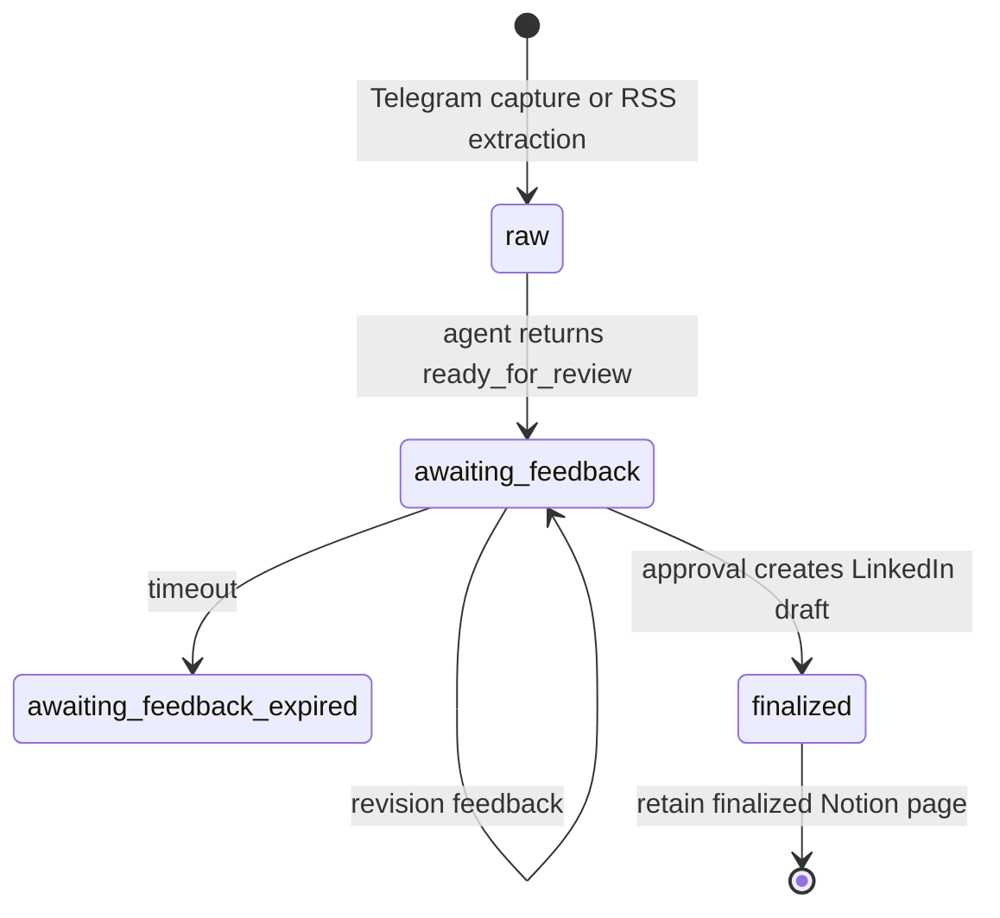
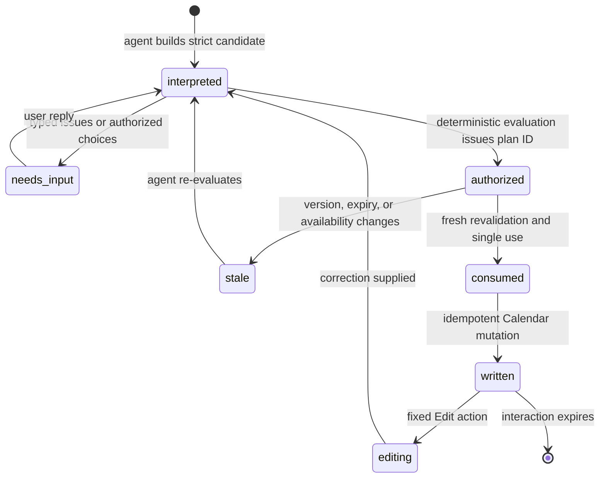
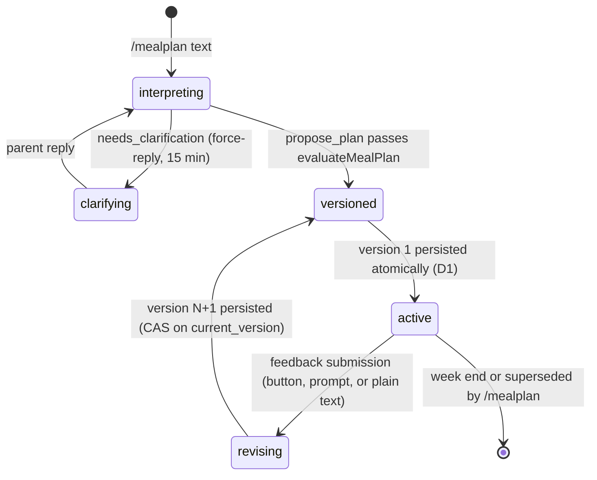

# Data and state

Kipp intentionally splits state by lifecycle, sensitivity, and owning
workflow. It does not use a general-purpose application database.

```mermaid
flowchart LR
  telegram["Telegram ingress"] --> linkedinFlow["PipelineWorkflow"]
  telegram --> calendarFlow["CalendarWorkflow"]
  telegram --> mealFlow["MealPlanningWorkflow"]
  telegram --> notesFlow["NotesWorkflow - awaiting release"]
  rss["RSS trigger"] --> ingest["IdeaIngestDO SQLite"]
  telegram --> ingest
  ingest <--> ideas["Notion Ideas data source"]

  linkedinFlow <--> ideas
  linkedinFlow --> style["style-prompt.md"]
  linkedinFlow <--> router["InteractionRouterDO SQLite"]
  calendarFlow <--> router
  mealFlow <--> router
  mealFlow <--> mealDb["MEAL_PLANNING_DB D1"]
  mealFlow --> videoCache["RECIPE_VIDEO_CACHE KV"]
  linkedinFlow <--> vault["TokenVaultDO SQLite"]
  calendarFlow <--> vault
  linkedinFlow --> linkedinState["LinkedIn Workflow state"]
  calendarFlow --> calendarState["Calendar Workflow state"]
  mealFlow --> mealState["Meal-planning Workflow state"]
  notesFlow <--> router
  notesFlow --> vault
  notesFlow --> style
  notesFlow --> publication["BufferPublicationDO SQLite"]
  publication --> vault
  notesFlow --> notesState["Notes Workflow state"]

  subgraph notion["Notion"]
    ideas
  end

  subgraph github["Optional private GitHub repository"]
    style
  end
```

| Store | Data | Lifecycle and protection |
| --- | --- | --- |
| Notion Ideas data source | LinkedIn idea page bodies plus `Kipp ID`, status, source, Substack URL, chat ID, and idempotency-key properties | The LinkedIn content store. `IdeaIngestDO` serializes idempotent creation and claims a deterministic workflow instance per page. Calendar does not use this store. |
| Optional private GitHub repository | `style-prompt.md`, `notes-style-prompt.md` or configured prompt paths | Supplies author/audience instructions through the Contents API. Only missing files permit fallback; authorization and transport errors fail the read. Each Notes run snapshots content and provenance. |
| `IdeaIngestDO` SQLite | Idempotency-key ownership records; per-page workflow-start state and repair cooldown | Prevents duplicate Notion pages and workflow starts across Telegram, RSS, and cadence entry points. |
| RSS article model (transient) | Normalized title, optional subtitle, source URL, and ordered H2-section content produced from RSS `content:encoded` | Exists only during the RSS trigger and bounded extraction session; raw HTML is not persisted or sent to the agent. |
| `TokenVaultDO` SQLite | Short-lived OAuth state; provider-namespaced encrypted LinkedIn and Google Calendar tokens; Buffer grant, PKCE verifier, credential generation, connection identity, and refresh claim (implemented; awaiting release) | OAuth state expires after five minutes. Tokens use AES-256-GCM and configured key IDs and can be rewrapped during rotation. Only Buffer refresh is coordinated inside the vault; see the policy below. |
| `BufferPublicationDO` SQLite (awaiting release) | One immutable approved payload and fingerprint, approval evidence, dispatch claims, numbered attempts and typed results per publication | No automatic deletion: losing dispatch evidence could permit duplicate replay. Each authorized attempt sends at most one create; accepted or uncertain attempts never acquire another send claim. |
| `InteractionRouterDO` SQLite | Opaque callback or reply registration, workflow target, interaction kind, version, expiry, and delivery state | Legacy routing entries contain no request prose or credentials. Notes deliveries additionally retain the authenticated feedback text needed for transport replay; see below. Entries expire after the owning interaction window and bounded grace. |
| `PipelineWorkflow` state | LinkedIn agent transcript, review version, approval or revision events, usage, and step results | Durable across the configured feedback wait. Transcript output is bounded before persistence. |
| `NotesWorkflow` state (awaiting release) | Prompt/model/timezone snapshot, original thoughts retained during setup, destination pinned before writing, bounded transcript, receipt anchors, exact candidates and processed event IDs | Initial generation plus four follow-ups within configured feedback wait capped at 11h45m. Authenticated Continue resumes setup before drafting without spending a writing session or extending the deadline. Uses the existing Workflow retention conventions; no separate transcript deletion job. |
| `CalendarWorkflow` state | Bounded safe transcript, versioned plan/option ledger, exact evaluated plans, created-event baseline, and interaction events | Exists for the 15-minute Calendar conversation. Provider reasoning is removed; obsolete event-list results are compacted; IDs expire and are single-use. |
| `MEAL_PLANNING_DB` D1 | Household profile (seeded), active plan header, immutable plan versions, sole feedback-batch ledger, private Mini App review contexts, opaque session digests, launch replay fingerprints, and the chat-scoped plan-message generation counter | The canonical meal-planning store. One active plan per chat; Mini App authority is derived from verified Telegram launch data and a server-owned context, never client plan/chat IDs. Feedback batches move `accepted → delivered → processing → consumed`, with terminal `stale`/`failed` states; revisions are CAS-guarded and change nothing when stale. No transcripts, raw launch data, bearer tokens, or provider text are stored. |
| `RECIPE_VIDEO_CACHE` KV | Per-dish/slot recipe-video search results for lunch cells | Optional enrichment cache with a 24-hour per-key expiry (`expirationTtl`), so it needs no expiry sweep. A missing or stale video never blocks a plan. |

Notes extends `InteractionRouterDO` with separate action, message-binding,
version and delivery tables. It atomically retains the authenticated event
when consuming an action, then acknowledges it after forwarding. Feedback
envelopes retain the parser-selected first URL alongside the original text, so
masked-link targets survive delivery replay without reparsing changed offsets. Same-update
or pending same-action redelivery returns the original event. Cleanup is lazy
at the review deadline plus the existing one-hour grace. This is transport
recovery for Notes, not support for concurrent Telegram feedback conversations.

Buffer publication JSON now also retains exact normalized timing, attempt ordinal,
rejection time and consumed Retry delivery IDs. Each prepared/preflight attempt is
recorded before I/O; dispatch claims are synchronized before create. Only a matching
authenticated Retry of a definitive no-create rejection can prepare the next attempt.
Rejected guards can be sealed as superseded before changed content/timing is reviewed.
Accepted, unknown and unexpected-created outcomes cannot reopen dispatch. This extends
the existing JSON/attempt records and requires no new SQLite tables or binding migration.

Calendar event content is not copied into the Notion Ideas data source or
the interaction router. The model can see only user text and the narrow event
projection explicitly returned by `list_calendar_events`; descriptions,
locations, attendees, organizers, conferencing data, links, credentials, and
raw provider responses remain outside model context and content logs.

## Provider refresh ownership

Buffer is a deliberate exception to the existing token-storage boundary. Its
vault-owned refresh persists a claim before contacting Buffer and saves both
replacement tokens before returning access. Overlapping callers share the live
refresh inside the same vault instance. The claim survives a restart; an
unresolved claim requires reauthorization rather than reuse of a potentially
consumed refresh token. Credential generations prevent a late refresh response
from overwriting a newer authorization.

LinkedIn and Calendar continue to use the vault for encrypted storage, without
coordinated refresh: LinkedIn's scheduled token check owns its refresh, and the
Google Calendar API client refreshes during requests. Shared storage alone does
not serialize either provider's complete read-refresh-write operation.

Do not extend coordinated refresh to LinkedIn or Calendar until concurrent
workflows are explicitly supported and that extension is explicitly approved.
Buffer's protection does not enable concurrent Telegram feedback conversations.
The rationale and release status are recorded in
[ADR-003](decisions/ADR-003-buffer-only-coordinated-refresh.md).

## LinkedIn idea lifecycle



`drafted` and `skipped` remain valid data statuses for compatibility, but the
current workflow moves generated content directly to `awaiting-feedback`.

Substack extraction is an exception to that general path: its ideas remain
`raw`, are excluded from the scheduled cadence check, and enter LinkedIn
drafting only after an explicit `/generate` request.

RSS ingestion keys are versioned with the generation contract. A deliberate
namespace bump is the reset mechanism for stale `IdeaIngestDO` records after a
workflow overhaul; it avoids reusing a prior key-to-Notion-page mapping while
leaving unrelated Telegram/manual state untouched.

## Calendar plan lifecycle



The workflow persists a complete created-event baseline after a write so an
immediate edit can re-evaluate without guessing or recreating the event.

Substack article HTML is transient workflow input. `linkedom/worker` removes
known media and interface subtrees and emits only authored prose blocks; the
bounded agent receives the compact article model and submits ranked raw ideas.

## Meal-planning plan lifecycle



A created plan is approved by default. One instance lives per chat-week; a
fresh `/mealplan` supersedes the active plan (last-commit-wins, one active
plan per chat), and superseded action buttons and prompts resolve nothing via
the chat-scoped generation counter.
