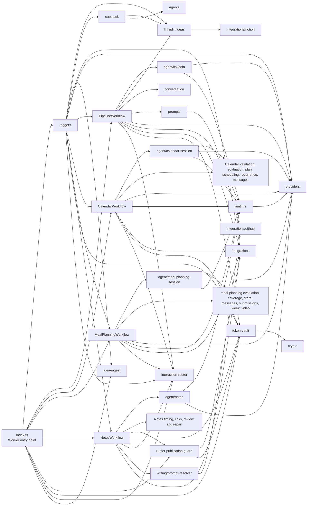

# Modules

The dependency direction is from orchestration and entry points toward domain
modules and integrations. LinkedIn, Calendar, and Meal planning share provider,
runtime, and interaction-routing infrastructure while retaining separate
workflow policy. Meal planning adds the D1 and KV stores and the YouTube Data
API integration as its own domain surface.

## Interactive conversation contract

LinkedIn, Calendar and Notes use `core/conversation-turn.ts` and
`core/conversation-presenter.ts` for interactive responses. A user turn has one
response purpose: connection recovery, clarification, review, confirmation or
failure. Connection recovery is the sole response to that input; it does not
include a draft or clarification, and its controls cannot offer approval.
Provider checks remain workflow policy: Notes checks before drafting, LinkedIn
checks at publication, and Calendar can discover missing authorization during reads.

New interactive workflows should create a `createConversationTurn()` coordinator
for each accepted input and call `turn.respond(response, deliver)`. Pass the same
coordinator to helpers handling alternative branches. Create the next coordinator
only after another authenticated interaction or a timeout; an internal model or
provider retry is not a new user turn. The coordinator reserves the response
synchronously, preventing competing branches from sending different responses.

The presenter joins ordered review sections with blank lines, sends literal text
with link previews disabled, and splits only responses exceeding 4,000 UTF-16 code
units. Sections that fit stay intact where possible. Splitting preserves text
and surrogate pairs; controls appear only on the
last part. Inline buttons always use one button per row, preserving their reading
order. The Telegram client enforces the same layout for callers outside the
presenter, including meal planning. Workflows supply their content labels and
separators and bind returned message IDs using their existing routing policy. Published content remains a
separate domain value, never extracted from the presentation.

For legacy adapters that prepare controls inside an existing delivery checkpoint,
call `turn.claim(kind)` outside the checkpoint, then use
`presentConversationTurn` inside it. Claiming outside the checkpoint reconstructs
the reservation on replay even when delivery is cached. Retry the same delivery
inside that reservation; do not clear the coordinator after an error to send a
competing response. The coordinator is local control flow, not durable approval
authority or a cross-workflow lock. Existing checkpoints, routing, approval
guards and write recovery retain those responsibilities.

`__tests__/conversation-turn.test.ts` covers the shared contract and presenter.
Integration and live sanity journeys also apply
`__integration__/helpers/conversation-contract.ts` to actual workflow messages,
including exclusive reconnect responses. Meal planning's Mini App conversation
has not been migrated to this interface.

## Dependency map

| Module | Responsibility | Key dependencies |
| --- | --- | --- |
| `triggers/` | Adapts HTTP, Telegram, OAuth, and scheduled events into application actions. | Ideas, IdeaIngest, integrations, providers, both workflows, interaction router, token vault |
| `substack/` | Parses the triggering RSS item's complete `content:encoded` HTML into a compact article model and runs the bounded source-grounded idea-extraction session. | `linkedom/worker`, providers, runtime, ideas, integrations |
| `linkedin/workflow.ts` | Orchestrates bounded LinkedIn native-tool drafting/revision, notification, approval wait, deterministic publication, and Notion lifecycle updates. | Agents, ideas, conversation, integrations, interaction router, prompts, providers, runtime, token vault |
| `calendar/workflow.ts` + `calendar/agent-workflow.ts` | Runs the bounded Calendar agent session, persists its safe transcript and opaque plan ledger, maps fixed actions, revalidates fresh state, and performs idempotent writes and recovery. | Calendar agent, Calendar domain, Google Calendar integration, interaction router, providers, runtime, token vault |
| `calendar/validation.ts` + `calendar/evaluation.ts` + `calendar/plan.ts` | Defines strict one-off/recurring proposal validation, aggregates typed semantic issues, evaluates safe candidates, and authorizes versioned single-use plan and option IDs. | Scheduling and recurrence domains, Google Calendar integration |
| `calendar/scheduling.ts` + `calendar/recurrence.ts` + `calendar/messages.ts` | Implements time-zone conversion, availability policy, recurrence expansion, candidate selection, Calendar event projection, and deterministic operational or post-write messages. | Shared types, Google Calendar types, `rrule` |
| `meal-planning/workflow.ts` + `meal-planning/agent-workflow.ts` | Runs the bounded meal-planning agent session, enriches lunch cells with optional recipe videos, persists plans atomically, sends Telegram feedback and contextual Mini App review actions, and parks in a week-long live loop that turns claimed feedback batches into revisions. | Meal-planning domain, agent, providers, runtime, interaction router, D1 store, KV video cache |
| `meal-planning/mini-app-auth.ts` + `meal-planning/mini-app-routes.ts` + `meal-planning/mini-app/` | Verifies Telegram Mini App launch data, issues short-lived opaque sessions, exposes an authorized ready-or-empty plan DTO, accepts idempotent feedback batches, and serves the dependency-free phone review client. | Telegram bot token, D1 binding, MealPlanningWorkflow |
| `meal-planning/store.ts` | D1 client (plus in-memory fake) for the household profile, active plan, immutable plan versions, sole feedback-batch ledger, private review contexts, short-lived sessions, and generation counter; enforces one-active-plan and stale-rejection invariants atomically. | D1 binding |
| `meal-planning/evaluation.ts` + `meal-planning/coverage.ts` + `meal-planning/corpus/` | Deterministic `evaluateMealPlan` over typed candidates, the coverage-set resolver, and the validated #64 scenario corpus. | Shared types |
| `meal-planning/messages.ts` + `meal-planning/submissions.ts` + `meal-planning/week.ts` | Deterministic plan rendering, the canonical `Submission`/`FeedbackItem` payload coercion, and Mon–Sat week resolution. | Shared types |
| `meal-planning/video.ts` | Optional, never-blocking YouTube recipe-video discovery for school-lunch and home-lunch cells with a 24 h KV cache and a per-plan call ceiling. | YouTube Data API, KV namespace |
| `linkedin/ideas/` | Manages Notion-backed idea creation, retrieval, lifecycle updates, and metadata queries. | Notion integration |
| `core/idea-ingest.ts` | Serializes idempotent Notion ingestion and owns deterministic workflow starts per idea page. | Ideas, Notion integration, PipelineWorkflow, Durable Object SQLite |
| `agent/` | Defines workflow-specific bounded sessions, prompts, tool contracts, safe transcript handling, and terminal outcomes: Calendar `ready_to_create`/`needs_user_input`, LinkedIn `ready_for_review`, and Meal-planning `propose_plan`/`needs_clarification`. | Providers, runtime, Calendar evaluation and plans, Meal-planning evaluation |
| `providers/` | Selects Gemini, DeepSeek or OpenRouter and normalizes text generation plus native tool declarations, calls, and results. Notes pins GPT-6 Luna independently of shared LinkedIn/Calendar settings. | Provider SDK/API |
| `runtime/` | Supplies the typed tool registry and guard, three-turn/four-call bounded runner, batching and handoff policy, shared agent-session result, metadata-only logging, and HTTP constants. | Providers, Zod |
| `core/interaction-router.ts` + `core/interaction-router-client.ts` | Stores and resolves short-lived opaque Telegram interactions with idempotent claim/acknowledgement and expiry. | Durable Object SQLite |
| `core/conversation-turn.ts` + `core/conversation-presenter.ts` | Defines exclusive response purposes and semantic controls; composes literal Telegram messages, lossless size splitting and final-part controls. | Caller-owned checkpoints and Telegram delivery; no provider or publication authority |
| `integrations/` | Implements Notion, GitHub, Telegram, LinkedIn, Google Calendar and Buffer API clients. | External APIs |
| `writing/prompt-resolver.ts` + `core/time.ts` + `core/feedback.ts` | Shared prompt provenance with missing-file fallback, strict Luxon civil-time conversion and capped review deadlines. | GitHub, Luxon; reused by Notes and existing workflows |
| `linkedin/prompts/` | Resolves the style prompt from optional GitHub content with a built-in fallback. | GitHub integration |
| `core/token-vault.ts` + `core/token-vault-client.ts` + `core/crypto.ts` | Stores short-lived OAuth state and encrypted provider tokens; owns key rewrapping and Buffer-only coordinated refresh (implemented; awaiting release). LinkedIn's scheduled check and Calendar's API client retain refresh ownership outside the vault. See [ADR-003](decisions/ADR-003-buffer-only-coordinated-refresh.md). | Durable Object SQLite, Web Crypto; Buffer token endpoint for Buffer refresh only |
| `notes/workflow.ts` + `notes/runner.ts` + `agent/notes.ts` | Notes drafting and clarification, snapshotted prompt and exact text/card/timing approval; five bounded writing sessions. Implemented, awaiting release. | Shared provider/tool runtime, GitHub prompt resolver, Telegram, vault, publication guard |
| `notes/timing.ts` + `notes/publication.ts` | Strict timing proposals, receipt-anchored date/time resolution, mode-specific review/confirmation, and explicit bounded repair of confirmed no-create failures. | Shared time wrapper, Telegram, publication guard |
| `notes/links.ts` | First HTTP(S) destination in original text/entity order, including masked Telegram links; shared invocation/feedback metadata. | URL parsing; no article fetch |
| `notes/review.ts` + `notes/router.ts` | Exact candidate fingerprints, independent action validation, plain-text chunking and Notes-only retained authenticated delivery in the existing interaction router. | Web Crypto, router SQLite; does not enable concurrent same-chat feedback |
| `integrations/buffer/client.ts` + `substack.ts` + `publication.ts` | Shared Buffer transport/discovery, Substack capability mapping and one immutable publication per SQLite object. Persists each authorized attempt before create and acceptance before returning; only definitive no-create evidence permits Retry, and supersession seals rejected guards. Uncertainty never releases a send claim. | Buffer GraphQL, vault; no downstream polling |
| `core/conversation.ts` | Preserves serializable LinkedIn transcript state and enforces Workflow output limits. | Provider message types |

`types.ts` supplies shared data contracts. Tests are consumers of these modules,
not a production architecture layer.
