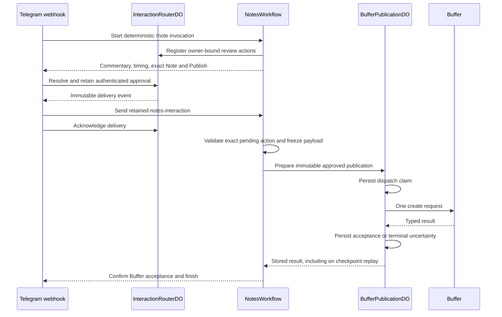
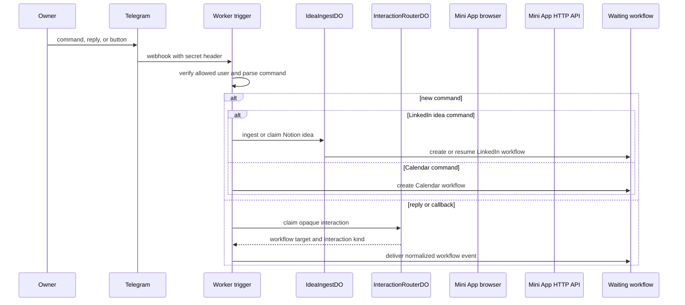
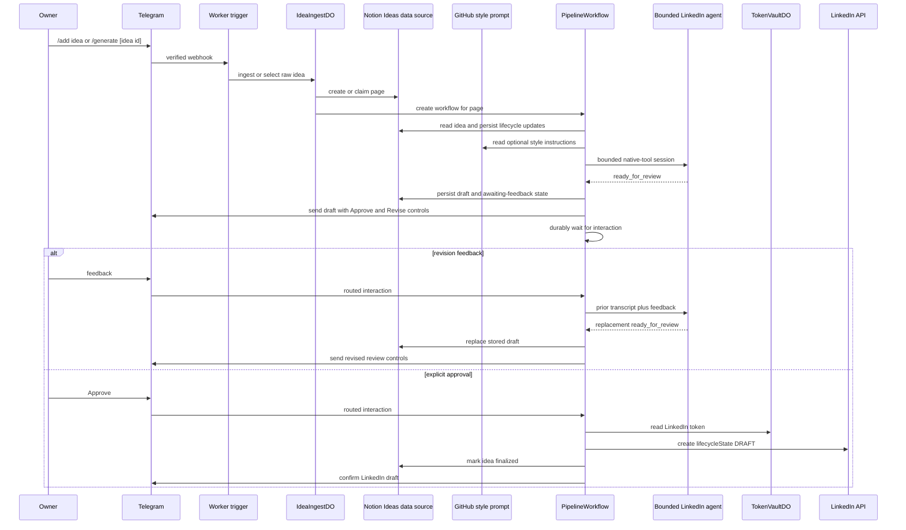
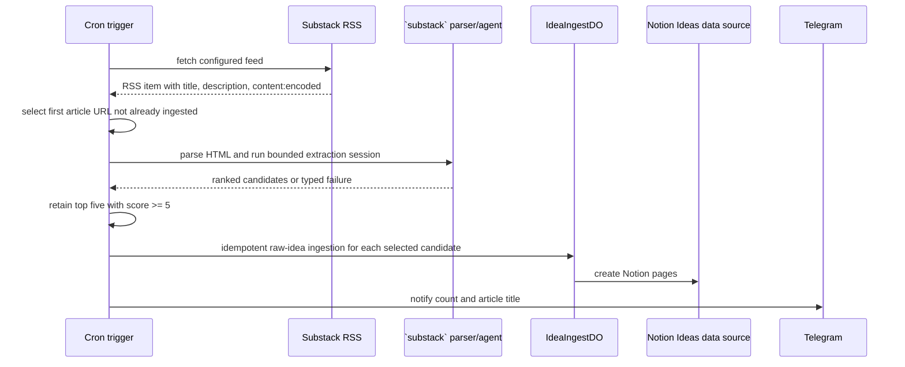
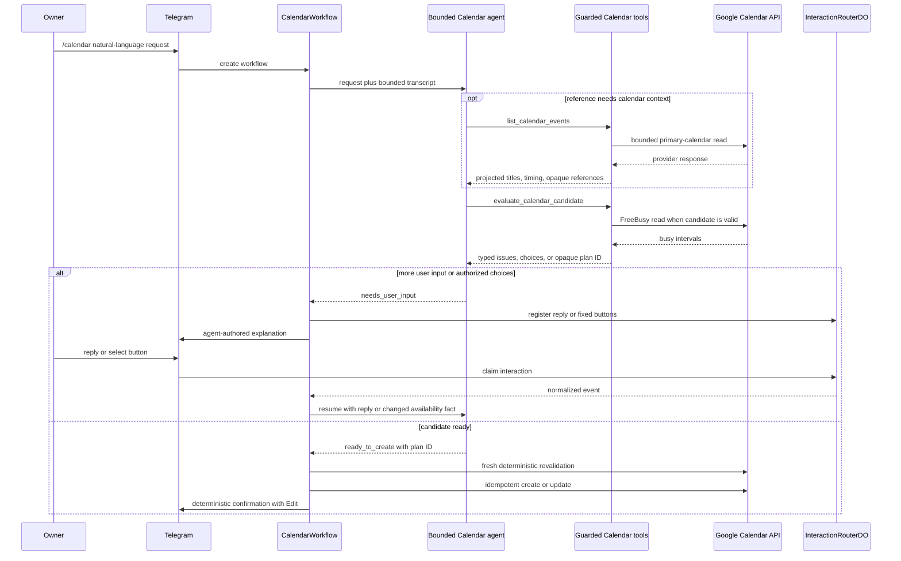
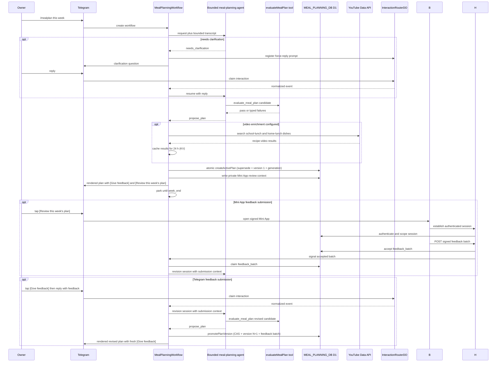
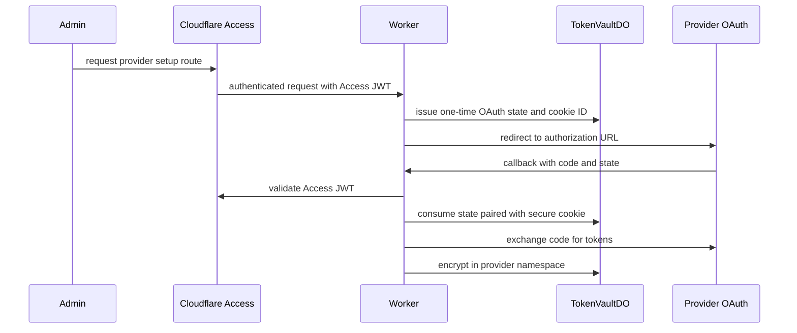

# Request flows

## Notes through Buffer (implemented; awaiting release)

An authenticated `/note <thoughts>` starts one deterministic Workflow instance
per Telegram chat/message. The run snapshots the writing prompt, model,
destination identity and feedback deadline, then uses the shared bounded tool
runtime to produce a necessary clarification or commentary and exact Note text.
The first HTTP(S) URL is parsed from original text and Telegram entities, then
carried separately as one card. Prose revisions preserve it; explicit feedback
can replace it from the reply’s first URL or remove it. Clarification has no
Publish action. Initial drafting, clarification and revisions share five writing
sessions and the original deadline. Failed bounded writing sessions throw from
the writing step, using the same default Workflow retries as LinkedIn without
spending another review round. After exhausted retries, recovery preserves the
latest valid draft or reports failure if none exists. Telegram displays commentary,
timing and the literal Note in that order. Publish authority is an opaque action
bound to the owner, chat, workflow, candidate version, fingerprint and deadline.
Writing feedback and model output cannot authorize publication. The writer supplies
structured now/queue/schedule intent separately from the Note text. Deterministic
time resolution uses the source message receipt and explicit/default timezone;
invalid, missing, ambiguous or elapsed scheduling requires clarification. Prose
revisions preserve timing. Queue approval delegates the next slot to Buffer; the
confirmation shows returned `dueAt` without polling or inventing a timestamp.



Resolve/forward/ack failure returns HTTP 503 for Notes so webhook redelivery can
reuse the retained event. The Workflow rejects stale or duplicate events. A
publication with an existing dispatch claim never acquires another send lease;
replay returns its durable evidence. Only an incomplete result with a captured
post ID permits one bounded lookup of that ID. There is no downstream delivery
polling or inspection-and-retry interaction. A definitive no-create rejection is
a separate path: offer repair and explicit Retry of the unchanged payload, with
fresh owner/action/attempt validation and at most three attempts. The repair wait
is at most fifteen minutes within the original review deadline and scheduled due time. A
changed payload seals the rejected guard before fresh review; unknown, dispatching,
accepted and unexpected-created evidence cannot be superseded into another create.

The Notes transport extension leaves existing provider refresh ownership intact:
Buffer alone uses vault-coordinated refresh under
[ADR-003](decisions/ADR-003-buffer-only-coordinated-refresh.md). Concurrent
same-chat feedback remains unsupported.

## Telegram ingress and interaction routing

Telegram commands ingest or start work; replies and callback buttons resume the
specific waiting workflow through short-lived opaque registrations.



## LinkedIn idea capture, generation, and review

Telegram `/add` and RSS create raw pages in the Notion Ideas data source through
`IdeaIngestDO`. `/generate [idea id]` (the oldest raw idea by default, or the
named raw idea) and the weekly cadence check may start `PipelineWorkflow`; RSS
ingestion only stores raw ideas and starts no workflow until an explicit
`/generate`. `IdeaIngestDO` ensures a page has at most one active deterministic
workflow instance.
The LinkedIn agent returns a workflow-specific `ready_for_review` terminal
outcome; it cannot approve, publish, archive, or access credentials.



No LinkedIn post is auto-published. If feedback does not arrive within
`WAIT_FOR_FEEDBACK_HOURS`, the idea becomes `awaiting-feedback-expired`.

## RSS Substack idea extraction

The daily RSS trigger uses the triggering item's `content:encoded` field as
the sole v1 article-body source. It keeps the RSS title and subtitle metadata,
projects the HTML through the `substack` parser, and passes the resulting
title/subtitle/source URL/H2-section model directly to a bounded idea agent.
The agent submits up to seven ranked candidates through its private tool;
deterministic code keeps the top five candidates scoring at least five and
creates them as raw Notion ideas. The run sends one Telegram summary and does
not start LinkedIn drafting or cadence processing for those ideas.



RSS `content:encoded` is treated as a syndication input rather than a
guaranteed platform contract. The parser rejects missing or implausibly empty
body content and reports a typed failure; v1 does not add a scraping service,
browser binding, or undocumented Substack API fallback. Images, captions,
subscribe widgets, and other interface markup are removed before model input.
Transient RSS fetch failures (network errors, HTTP 429, and HTTP 5xx) receive a
bounded retry policy of up to three retries. Parsing, agent, or Notion failures
do not create partial ideas; the next RSS poll can retry the unseen article.
Telegram notification is best-effort and is sent only after all selected ideas
have been stored successfully.

## Calendar conversation, evaluation, and write

Calendar uses a bounded agent to interpret ordinary language and explain typed
outcomes. Deterministic evaluation owns date arithmetic, policy, recurrence,
FreeBusy checks, candidate ranking, and opaque plan authorization. Only the
workflow can revalidate and write.



`list_calendar_events` is limited to the primary calendar, a 31-day range, 50
projected events, and safe fields. `evaluate_calendar_candidate` performs
availability checks; neither model-facing tool mutates Calendar. Opaque plan
and option IDs are version-scoped, expiring, and single-use. A successful write
is never repeated merely because Telegram confirmation failed.

## Meal-planning conversation, persistence, and revision

Meal planning uses a bounded agent to interpret the parent's request and
week-relevant context. The deterministic evaluator owns plan validation;
only the workflow can persist. A plan is approved by default, and every
Mini App feedback submission is first accepted into the `feedback_batch`
ledger. The workflow later claims it and either produces a CAS-guarded revision
or records the terminal `stale` or `failed` state. Telegram text feedback goes
directly to `submissionFromPayload(payload)` and is not entered in that ledger.



No transcripts or raw provider text are stored in D1. The active plan is the
canonical store contract the iteration-2 Mini App reads; video enrichment is
optional and never gates a plan.

The Mini App posts only signed Telegram launch data to establish a short-lived
server session. Its plan read is `ready` only for the active current-week plan
in that session's private chat; otherwise it is an `empty` response that sends
the parent back to `/mealplan`. An explicit batch is accepted into the sole
`feedback_batch` ledger before the workflow is signalled. The Mini App then
returns the parent to Telegram, which reports progress and the fresh review
link after a new version persists.

## OAuth setup

LinkedIn and Google Calendar use the same protected setup pattern and separate
provider namespaces in the encrypted token vault.



The weekly token check refreshes LinkedIn credentials when possible or alerts
the allowed Telegram user when reconnection is required. Calendar refreshes an
expired access token during a request and offers deterministic reconnect/retry
recovery when authorization is no longer usable.

### Buffer-only coordinated refresh

The Buffer connection implementation is awaiting release. Unlike LinkedIn and
Calendar, it acquires usable access through a vault-owned refresh operation.

```mermaid
sequenceDiagram
  participant C as Buffer caller
  participant V as TokenVaultDO
  participant S as Vault SQLite storage
  participant B as Buffer token endpoint

  C->>V: acquire Buffer access
  Note over C,V: Overlapping callers await the same live refresh inside the vault
  V->>S: persist claim for current credential generation
  S-->>V: storage write completes
  V->>B: exchange refresh token once
  B-->>V: replacement access and refresh tokens
  V->>S: verify generation and claim; save replacement pair without claim
  S-->>V: storage write completes
  V-->>C: return usable access
```

A usable unexpired token returns without a refresh. An unresolved claim after
restart or an uncertain exchange requires reconnection; the old refresh token
is not retried. A newer authorization fences late refresh results.

This is a Buffer-specific credential safeguard, independent of the unsupported
concurrent Telegram feedback capability. LinkedIn and Calendar retain their
existing refresh paths without coordination. Extending coordination to them is
deferred until concurrent workflows are explicitly supported and the extension
is explicitly approved. See
[ADR-003](decisions/ADR-003-buffer-only-coordinated-refresh.md).
