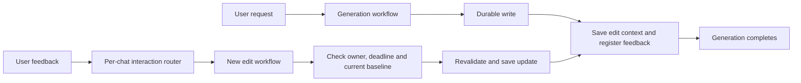

# Calendar and meal-plan edit lifecycle

Generation completes after the durable write, confirmation, and feedback
registration. There is no post-save event wait, expiry alarm, or scheduled
workflow restart. Pending clarification, conflict selection, authorization
recovery, and LinkedIn approval still use durable event waits because those
decisions precede the requested write.

The existing Calendar and meal-planning bindings accept generation and edit
parameters. An edit is a new instance, rather than a message to a completed
instance. Deterministic instance IDs deduplicate Telegram updates and Mini App
batches, including a retry after losing the create response. Edit actions may be reused
for a new update while their baseline is current; replaying the same update
finds the same run. Legacy interaction
registrations without edit metadata continue to deliver events to waiting runs.

Calendar context lives in the chat's interaction-router Durable Object. It
contains the exact created plan, original Telegram identity used to derive the
managed event ID, native transcript, owner, and deadline. Each confirmation
opens a new 15-minute edit window. An Edit tap only sends a force-reply prompt
and registers it; feedback starts the scheduling edit run. Reply registration
cannot extend the confirmation's edit deadline. A successful update invalidates
the old baseline. Expired context is denied immediately and physically pruned
on subsequent context saves after a one-hour retention allowance.

Meal-plan context remains in D1. Feedback is allowed until the saved plan's
week ends, subject to active-plan and version checks. Buttons, replies,
unaddressed text and Mini App batches start independent edit runs. Mini App
runs claim and use the server-owned batch; client-supplied items are not trusted.
Plan promotion retains its compare-and-swap guard. Context updates and any
follow-up planning use distinct durable step names.

A per-resource Durable Object lock serializes edit runs. Busy edits receive a
retry notice; Mini App batches become terminal failures rather than remaining
undelivered indefinitely. Lock release checks the owning instance. If a run is
terminated or fails before release, a later edit may recover the lock only after
the workflow API confirms a terminal status. Active, paused, waiting and unknown
runs retain their locks. Calendar feedback rechecks its baseline after acquiring
the lock, so a competing successful edit cannot leave stale write authority.

Runtime interruption signals (pause, restart, termination and grace-period
eviction) propagate through application error handling. A suspended edit keeps
its lock and does not send a failure notice or mark a Mini App batch failed.
On recovery, completed durable steps restore their results. A terminated run's
lock is recovered by a later edit after the terminal-status check above.
This recovery differs from an explicit Workflow `restart()` operation, which
resets step history by default.

This change introduces additive SQLite tables and an interaction metadata column
inside the existing Durable Object. It adds no Worker binding, D1 migration,
secret, runtime variable or production timer. Calendar ETag protection against
manual Google Calendar edits remains outside this change.

The Calendar integration suite verifies delivery and lock recovery using actual
Workerd Workflow instances and the production router in a SQLite Durable Object.
It covers duplicate delivery, a lost create response, active-run exclusion,
terminal-run recovery, owner-checked release and redelivery after completion.
The probe uses no external Calendar or Telegram APIs. Runtime status labels are
not used to infer that a run has reached its event wait; the test observes lock
acquisition directly because Miniflare can report an event-blocked run as running.

Additional runtime tests run the production Calendar workflow and agent with
only provider, Calendar and Telegram service boundaries replaced. They pause
an edit after its durable write and before context storage, confirmation, or
feedback registration, dispose the runtime, then boot a fresh runtime over the
same persisted databases and resume. Assertions verify retained locks, restored
feedback registration, no misleading failure notice and no repeated provider
calls, write or completed confirmation. Deterministic tests cover the analogous
meal-plan promotion/notification boundaries, batch failure and contention,
uncertain workflow statuses, overlapping lock recovery, context changes before
lock acquisition and router reconstruction from SQLite.

The runtime recovery suite also uses the production Google adapter and encrypted
token vault against a simulated Google service. It loses a create or update
checkpoint after Google accepts the write, then pauses, reboots and resumes the
Workflow. Retried creates retain their deterministic event ID; retried updates
retain the same event and body. If every update response is lost, the adapter
confirms success only after reading back all managed fields and matching the
intended update, including request ownership. This verifies an uncertain write;
it does not add ETag protection against external edits.

The authorization regression starts with an expired token and rejected refresh,
reboots during the reconnect prompt, restores credentials through the production
vault, and delivers Retry. It then reboots again after creation and resumes past
the original plan deadline. Creation remains singular, the new Edit registration
is usable, and no delayed failure is sent. The browser OAuth redirect and Google's
token exchange remain outside this runtime test.

Meal runtime tests persist and reopen real D1, Workflow and router databases at
promotion, notification and feedback-registration boundaries. A committed revision
whose response or checkpoint is lost is recovered only when the current version,
plan, operation identity and candidate match. Telegram revision operation IDs are
scoped to the edit instance and revision occurrence; Mini App batches retain their
server-owned batch ID. Recovery does not promote another version or bump the
message generation. Mini App batch ownership is checked against the chat and
original plan instance before claiming a batch or changing its status.

Telegram send acceptance and Workflow checkpointing are not atomic. A lost send
response or checkpoint can produce a duplicate confirmation on retry. The runtime
test verifies that recovery repeats no Calendar write and registers usable Edit
controls, while tests of already-checkpointed sends continue to require no
duplicate confirmation. Shared action prompts propagate runtime interruptions
instead of converting them into ordinary interaction failures.
