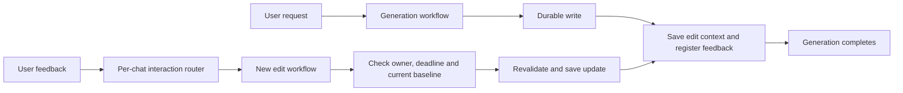

# Calendar and meal-plan edit lifecycle

Generation completes after the durable write, confirmation, and feedback
registration. There is no post-save event wait, expiry alarm, or scheduled
workflow restart. Pending clarification, conflict selection, authorization
recovery, and LinkedIn approval still use durable event waits because those
decisions precede the requested write.

The existing Calendar and meal-planning bindings accept generation and edit
parameters. An edit is a new instance, rather than a message to a completed
instance. Deterministic instance IDs deduplicate Telegram updates and Mini App
batches, including a retry after losing the create response. Edit actions may be reused
for a new update while their baseline is current; replaying the same update
finds the same run. Legacy interaction
registrations without edit metadata continue to deliver events to waiting runs.

Calendar context lives in the chat's interaction-router Durable Object. It
contains the exact created plan, original Telegram identity used to derive the
managed event ID, native transcript, owner, and deadline. Each confirmation
opens a new 15-minute edit window. An Edit tap only sends a force-reply prompt
and registers it; feedback starts the scheduling edit run. Reply registration
cannot extend the confirmation's edit deadline. A successful update invalidates
the old baseline. Expired context is denied immediately and physically pruned
on subsequent context saves after a one-hour retention allowance.

Meal-plan context remains in D1. Feedback is allowed until the saved plan's
week ends, subject to active-plan and version checks. Buttons, replies,
unaddressed text and Mini App batches start independent edit runs. Mini App
runs claim and use the server-owned batch; client-supplied items are not trusted.
Plan promotion retains its compare-and-swap guard. Context updates and any
follow-up planning use distinct durable step names.

A per-resource Durable Object lock serializes edit runs. Busy edits receive a
retry notice; Mini App batches become terminal failures rather than remaining
undelivered indefinitely. Lock release checks the owning instance. If a run is
terminated or fails before release, a later edit may recover the lock only after
the workflow API confirms a terminal status. Active, paused, waiting and unknown
runs retain their locks. Calendar feedback rechecks its baseline after acquiring
the lock, so a competing successful edit cannot leave stale write authority.

This change introduces additive SQLite tables and an interaction metadata column
inside the existing Durable Object. It adds no Worker binding, D1 migration,
secret, runtime variable or production timer. Calendar ETag protection against
manual Google Calendar edits remains outside this change.
