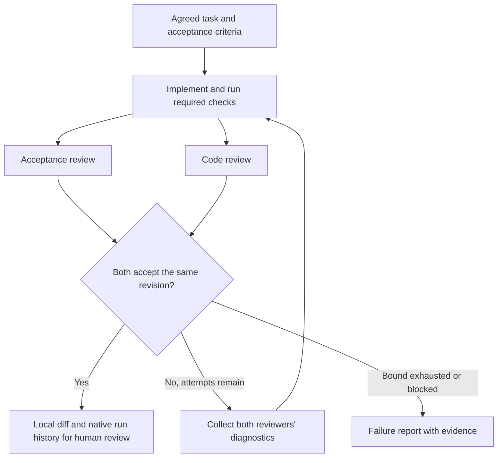

# Zeroshot experiment 1: implementation, review, and repair

Date: 6 November 2026

Documentation issue: `agent-harness-bpzg`  
Candidate implementation issue: `agent-harness-vz5`  
Background: [Zeroshot autonomy research](../docs/research/zeroshot-autonomy-trials.md)

This document captures the agreed first experiment. It does not start a run or authorize installation, commits, pushes, PR creation, or deployment. Beads remains the source of task status; this file is the experiment specification.

## Purpose

Determine whether Zeroshot reduces the owner's time supervising implementation and review. The desired experience is one kickoff, autonomous implementation/review/repair, and one final human review of the result.

The pilot exercises Zeroshot's explicit routing, independent reviewers, bounded repair loops, and durable execution evidence. It tests the central part of the larger desired workflow before adding planning loops, multiple implementation iterations, or PR feedback handling.

## Scope

Use one agreed task, one implementation worker, and two reviewers with distinct responsibilities. Both reviewers must accept the same workspace revision before the run reports success. A rejection returns actionable feedback to the worker. Exhausting the configured repair bound produces a failure report.

The first output is a local diff for human review, with check outcomes and review diagnostics retained in Zeroshot’s native run history. No separate evidence files are required.

## Candidate task: structured meal-context diagnostics

Use `agent-harness-vz5`, subject to a source check immediately before launch. The initial investigation found comma-separated extraction diagnostics in `src/meal-planning/agent-workflow.ts` and primitive-only `details` typing in `src/runtime/logging.ts`.

The task's acceptance criteria are:

- Inventory diagnostics contain separate arrays for available and unavailable ingredients.
- Exception diagnostics contain structured summaries with only approved, non-sensitive fields.
- No-op extraction represents empty results explicitly as empty arrays.
- Free-form household instructions and quantity notes are excluded from the diagnostic fields.
- Existing extraction schemas and meal-planning behavior remain unchanged.
- Existing regression suites cover populated results, no-op results, and privacy omissions; the event shape is documented.
- Any change to shared logging types preserves the metadata-only logging contract.

Inspect current code and the latest Beads criteria before starting. If the issue is already resolved, select another bounded task rather than manufacture work. Do not claim or close the implementation issue merely because this specification exists.

## Stage contracts

| Stage | Responsibility | Required evidence or outcome |
| --- | --- | --- |
| Kickoff | Supply the task requirements and acceptance criteria; let agents discover repository context | Concise task input and recorded baseline |
| Worker | Implement the task; run checks; address all rejection diagnostics | Local changes, verification results, and explanation of remaining limitations |
| Acceptance reviewer | Check each criterion against implementation and meaningful test evidence | Accepted/rejected verdict with criterion-specific evidence and actionable gaps |
| Code reviewer | Check correctness, privacy, scope, shared contracts, and maintainability | Accepted/rejected verdict with concrete findings and evidence |
| Result | Join both verdicts and route to repair, success, or failure | Final revision identity, verdicts, check results, and limitations |

Reviewers inspect the completed worker changes and do not edit files. They may run checks that do not change the reviewed source. The worker and each reviewer retain their own separate sessions across passes within the same run, preserving prior implementation and review context. Each reviewer must still assess the current revision and verify whether previous findings are resolved. Both reviewers' diagnostics reach the worker before its next pass.

Freeze source edits during reviews. Record the baseline commit. Use sequential worker/check stages followed by parallel reviews. Reviewers have workspace-write permissions for test caches and temporary artifacts, with instructions prohibiting edits to source, tests, documentation and dependencies; source immutability is not a filesystem guarantee. Do not introduce commits or custom fingerprint files solely to identify revisions. Source changes invalidate previous approvals. A pass cannot combine acceptance of one revision with code approval of another.

## Configuration to prepare

Setup is now captured in [the pilot setup notes](../tools/zeroshot-pilot/README.md),
including the installed version, selected three-pass bound, native permissions, exact checks,
and remaining prelaunch rehearsal. The configuration includes a mechanical script check
gate before review; failure stops the run explicitly instead of entering repair.

Prepare a reusable graph, runtime configuration, and task input outside the target workspace. Record the installed Zeroshot version and use its matching documentation; `/current/` may describe unreleased behavior.

The graph must declare both review gates, feedback bindings, repair routing, finite attempt bounds, and explicit success/failure exits. Inspect the materialized graph before execution. Schema validation alone does not establish that the workflow behaves as intended.

Use the same harness/model configuration across roles initially to reduce setup variables. Separate reviewer responsibilities are intentional; cross-provider review is a later experiment. Record model, effort, session settings, and effective harness permissions. Disable Active Memory and its postmortem for the initial comparison so auxiliary model usage and changing cross-run context do not confound it.

The configured bound is three total worker/review passes: the initial pass and at most two repairs. Distinguish this bound from retries inside the harness. A graph iteration bound is not a monetary spending cap.

Use a dedicated clean worktree with project dependencies installed. Preserve the main checkout's existing files. Only one orchestrator controls this task; do not also start a TARS repair loop in that worktree. A coordinator owns Beads updates.

## Verification gates

Run useful focused existing tests during development. The mechanical gate invokes the existing Lefthook pre-commit group with `rtk pnpm exec lefthook run pre-commit --force --no-auto-install --no-tty`. Lefthook owns the check definitions, including integration and migration suites; the pilot does not duplicate or narrow them. `--force` ensures checks run without staged changes.

Tests must verify observable behavior and privacy omissions. Do not create throwaway test files or weaken assertions to obtain acceptance. The candidate task needs no paid provider evaluation, live Telegram calls, production credentials, or runtime configuration changes.

Retain actual command outcomes in the native Zeroshot run log for each pass. Do not produce a separate evidence directory. An agent saying that checks passed is weaker than recorded execution evidence. Document whether a gate's verdict is derived mechanically from a command result or judged by an agent; do not claim stronger enforcement than the implementation provides.

The mechanical step returns a structured success result and passes its bounded
summary directly into both reviewers' `checkResult` inputs. Only successful command
execution reaches review. Reviewers use this result for full-suite verification and
run focused checks only when needed to investigate a specific concern. The worker
also leaves full-suite execution to the mechanical stage. This avoids duplicate
work and sandbox-dependent integration checks inside agent sessions.

## Orchestration rehearsal

Before the real task, exercise controlled outcomes through the configured routing and record the results:

| Case | Expected behavior |
| --- | --- |
| Acceptance rejects; code accepts | No success; acceptance diagnostics reach the next worker pass |
| Code rejects; acceptance accepts | No success; code diagnostics reach the next worker pass |
| Both reject | Both sets of diagnostics reach the worker |
| Both accept the same revision | Success is reachable |
| Rejection at the repair bound | Explicit failure; no success or publication |
| Required check fails or review execution cannot complete | Repair or explicit failure; no silent acceptance |

The deterministic rehearsal passed on 2026-11-06 under `agent-harness-x4w8`.
A temporary fake Codex executable used the upstream CLI fixture protocol with the
unchanged pilot graph. Fixed responses exercised all verdict combinations, feedback
delivery, three-pass exhaustion and interrupted-review failure. The fixture also
asserted resumed node session identities. The separately tested Lefthook step was
replaced with a no-op only in the rehearsal runtime. Outcomes and native run IDs are
recorded in [the setup notes](../tools/zeroshot-pilot/README.md#validation-and-launch).
This establishes routing behavior; actual model access, context retention quality
and native permissions are evaluated in the real pilot.

## Evaluation

Record these measures separately for setup/rehearsal and the real task:

| Measure | Why it matters |
| --- | --- |
| Owner minutes preparing, intervening, and reviewing | Primary measure of supervision cost |
| Mid-run interventions and their causes | Reveals where autonomy breaks down |
| Review/repair passes | Shows whether feedback converges |
| Findings judged useful, redundant, or conflicting | Assesses reviewer value |
| Defects found in final human review | Checks whether autonomous acceptance was trustworthy |
| Elapsed time and reported model usage/cost | Exposes operational overhead; mark unavailable data explicitly |
| Routing and gate evidence | Shows whether the configured process was followed |

The target is no owner intervention between kickoff and the terminal result. Record interventions honestly if they are needed. No numerical time-saving target or cost threshold has been agreed.

Compare with a similar TARS task when a usable baseline exists. One successful run is evidence of feasibility, not proof that Zeroshot is faster or cheaper. Include preparation and final review when assessing attention saved.

## Completion and decision

### First run: interrupted by coordinator

Run `01a1b080-860c-7e00-ab19-6ccdbe20df67` ran on 2026-11-06 from approximately
16:26 to 16:33 Asia/Calcutta (7 minutes 27 seconds). Its final native result was
`failed / force_stopped`; it did not exhaust the three-pass limit or achieve approval.

The first worker pass changed four files in `codex/zeroshot-pilot-vz5`: structured
extraction summaries, the shared logging-detail type, existing workflow regression
tests, and README documentation. All six mechanical Lefthook jobs passed, including
874 unit-suite tests (34 skipped), integration and migration tests. Both reviewers
then rejected because their own test runs could not write Vitest temporary files
under the configured read-only sandbox. Neither rejection identified a code defect.

The captured harness prompt explains the conflict: Zeroshot adds runtime-owned
verifier guidance to run checks and create artifacts. Merely telling reviewers that
the earlier gate passed did not prevent duplicate test runs. Both diagnostics reached
the next worker pass, which resumed successfully but spent its time rerunning full
checks. The coordinator stopped that second pass after it stalled; no source changes
were made during repair. Reviewer session reuse was verified with the deterministic
fixture but not exercised by a second real review pass.

There were no user interventions during execution and one coordinator intervention
(force-stop). Owner preparation/review minutes and monetary cost are unavailable.
Native reported usage was 828,463 input tokens and 5,841 output tokens with
`complete: false`; treat this as incomplete reported usage, not a cost estimate.
The coordinator inspected the diff and found no additional concrete defect, but this
does not substitute for the unfinished review stages or the owner's final review.

The implementation bead remains in progress; the local diff is preserved without
commits, publication or deployment. Follow-up `agent-harness-hj6z` tracks reconciling
verifier permissions and mechanical-check handoff without custom evidence files.
This run demonstrates execution, gating and feedback routing, but it does not yet
demonstrate reduced supervision or a completed autonomous review loop. Fix that
configuration conflict before repeating or extending the experiment.

### Corrected run: successful

Run `01a1b08f-1410-7721-9ac5-25d621b6697c` succeeded on 2026-11-06 in one pass,
approximately 16:42:09–16:44:44 Asia/Calcutta (2 minutes 35 seconds between native
log timestamps). It reused the first run's local diff with the same task input.
The worker added coverage for whitespace/case normalization of the debug flag and
preservation of the existing `low` inventory status, without further production-code
changes. The full mechanical Lefthook group passed in approximately 16 seconds:
docs, lint, typecheck, migration, integration and unit tests (875 passed, 34 skipped).

Both reviewers received the mechanical summary as a graph input and explicitly
relied on it. Neither repeated the full suites. Both returned substantive acceptance
covering structured populated/empty diagnostics, privacy omissions, the unchanged
extractor/planning behavior, transcript controls, regression tests and documentation.
Neither reported an actionable defect or environment blocker. Comparing the raw Git
diff at review start and after success confirmed that reviewed files stayed unchanged;
the final status contains only the four expected modified files.

There were zero user or coordinator interventions between submission and success.
This excludes the configuration correction and deterministic rehearsal before launch.
Native reported usage was 724,838 input tokens and 3,595 output tokens with
`complete: true`; monetary cost and owner preparation/review minutes are unavailable.
These usage totals alone do not establish billed cost or savings over TARS.

Correction `agent-harness-hj6z` is complete. The implementation diff remains local,
uncommitted and unpublished, ready for the owner's final review. The coordinator's
diff inspection found no additional concrete defect. The real run demonstrates a
working implementation/check/review path with no supervision during execution;
repair routing and reviewer session reuse remain demonstrated by the deterministic
rehearsal rather than a second real review pass. Owner review and a comparable TARS
baseline are still needed to assess supervision savings.

The experiment is complete when the rehearsal results, terminal run result, final human review, and measurements have been captured. A bounded failure is a valid experimental result. The implementation issue closes only if its own acceptance criteria are satisfied.

Recommend extending the workflow only if the owner can review the result with less supervision and without unacceptable correctness gaps. Use intervention causes to decide the next change: stronger task criteria, better checks, different review responsibilities, or runtime improvements.

Deferred capabilities are planning/replanning loops, multiple planned implementation iterations, commits, remote delivery, PR feedback polling, merge handling, issue closure automation, production operations, and live planner experiments. Add these individually after the central loop demonstrates value.

## References

- [Zeroshot review-loop example](https://zeroshot.sh/docs/current/guides/review-loop/)
- [Execution model and delivery behavior](https://zeroshot.sh/docs/current/concepts/execution/)
- [Active Memory configuration](https://zeroshot.sh/docs/current/guides/active-memory/)
- [First-run configuration and validation](https://zeroshot.sh/docs/current/getting-started/first-run/)
